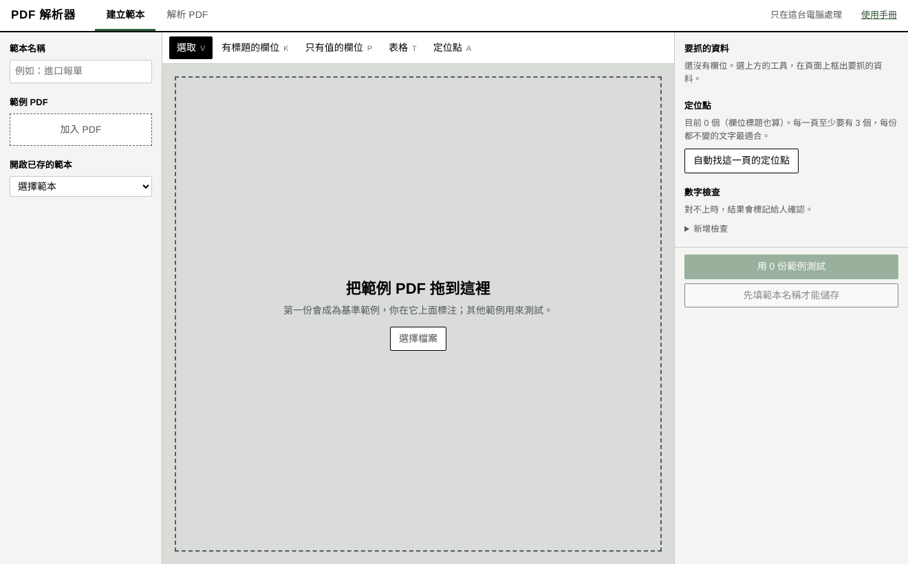
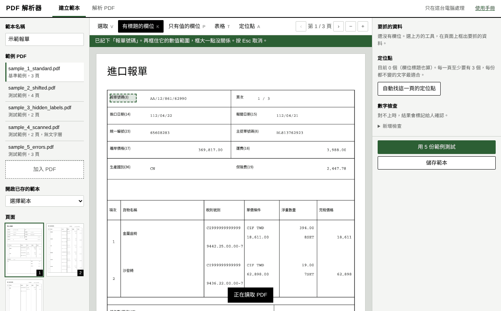
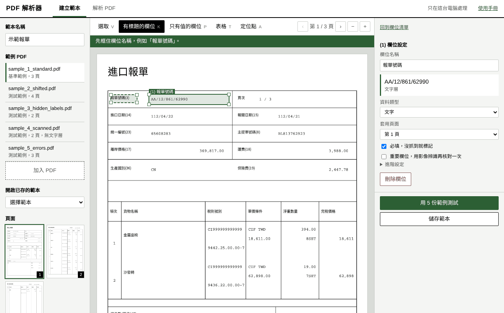
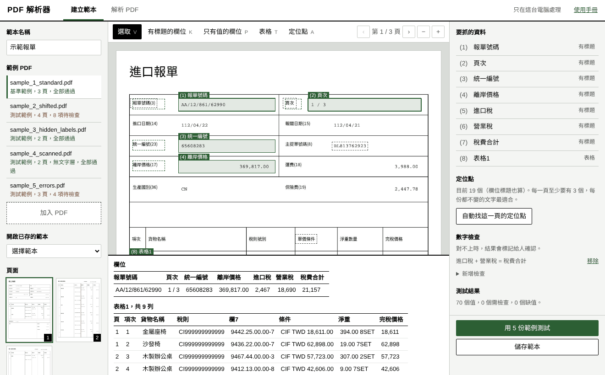
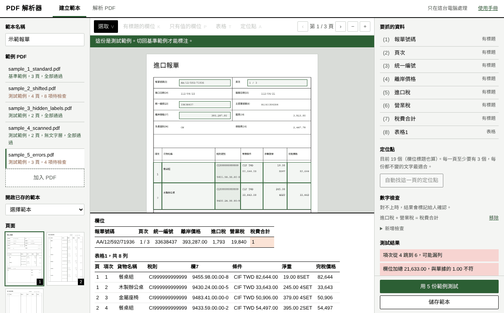
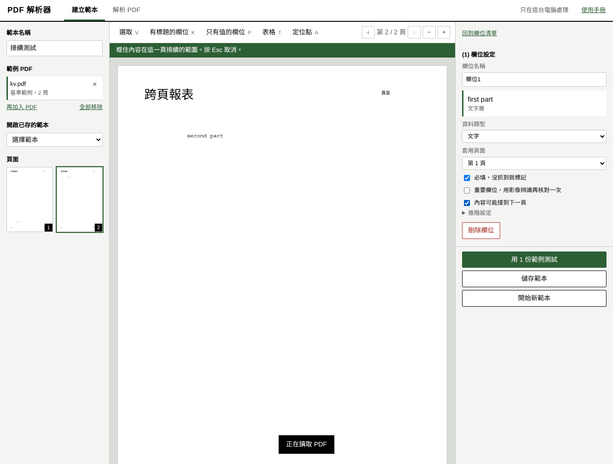
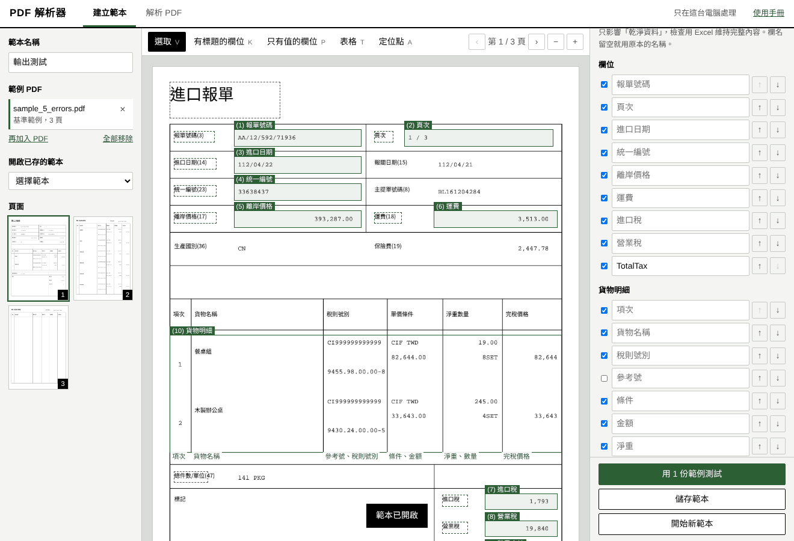

# PDF 解析器使用手冊

這個工具把格式相同的 PDF 批次轉成 Excel。你只要在一份範例上標出「資料在哪裡」，之後同格式的 PDF 就能自動抓取。抓得不確定的值會標出來，由人確認。

所有處理都在你自己的電腦上進行，檔案不會上傳到任何地方。

**這本手冊是參考手冊。** 一步一步的操作交給工具裡的新手導覽與實地練習，手冊放導覽教不到的東西：規則細節、例外、出錯怎麼辦。功能章節的標題和工具裡說明卡的標題一字不差，在工具看到什麼，就在手冊搜什麼。每個功能一節，格式固定：什麼時候用、怎麼設、例子、常見錯誤、在工具裡練習。

## 1. 開始使用

### 1.1 這個工具做什麼

使用分成兩階段。**建立範本**：每種單據做一次，由熟悉單據的人操作。**解析 PDF**：之後每次要處理新檔案時使用，工具依範本抓值，標出要人看的地方，再匯出 Excel。

<!-- shot: flow-overview -->

| 名詞 | 意思 |
|---|---|
| **範本** | 一份「資料在哪裡」的地圖。一種單據版本建一份，之後重複使用 |
| **基準範例** | 用來標注的那份 PDF，也就是加入的第一份 |
| **定位點** | 每份單據都不會變的文字，例如表單標題。工具靠它校正位置，所以單據稍微歪掉或偏移也抓得到 |

### 1.2 安裝、啟動與更新

#### 第一次安裝

不需要先安裝 Python，工具會自己準備。

**步驟一：取得工具。** 到公司 GitLab 專案的 **Releases** 頁，下載最新的 `pdf-mapper-版本.zip`。

**步驟二：解壓縮。** 解壓到固定位置，例如 `文件\pdf-mapper`。不要在壓縮檔裡直接執行。

> 從瀏覽器下載的 ZIP 要先解除封鎖再解壓，不然雙擊 `run.bat` 可能跳出安全性警告或沒有反應。步驟見[換版說明](換版說明.md)第 2 節。

**步驟三：啟動。**

- **Windows**：雙擊 `run.bat`。
- **macOS**：開啟終端機，進入資料夾後輸入 `bash run.sh`。

第一次會自動下載 uv 和 Python 3.12，約 1 到 3 分鐘。套件已經附在 ZIP 裡，不需要連到 PyPI。完成後瀏覽器會自動開啟工具。

啟動後，工具資料夾會長這樣：


記住一件事就好：**你的範本和匯出結果都在 `workspace`**。`app` 是程式本身，每次更新都會整包換掉，不要在裡面放自己的檔案。

> 全部都在這個資料夾內，電腦上原本的 Python 不受影響，也不會改動系統設定。不想用了，刪掉整個資料夾就好；要保留範本的話，先備份 `workspace\templates`。

#### 之後每次使用

雙擊 `run.bat` 就好。那個黑色視窗就是工具本身，**使用時不要關掉**。

用完時，關閉瀏覽器頁面或黑色視窗都可以。關閉頁面約 10 秒後，工具會自動結束，黑色視窗也會跟著關閉。正在解析時關閉頁面，工具會等解析完才結束，但結果來不及匯出就會消失。工具已經開著時再雙擊 `run.bat`，只會開啟原本的工具，不會多開一個。

#### 更新與退回版本

更新到新版、新版有問題時退回、從 0.1 版升級，都寫在 **[換版說明](換版說明.md)**，有圖解。換版不會動到 `workspace` 裡的範本和匯出結果。

更新程式時如果舊版的工具還開著，頁面上方會出現黃色提示「**程式已更新。請關閉所有工具分頁，再重新開啟 run.bat。**」。這代表硬碟上的程式已經換新，但背景還在跑舊版：請先把未匯出的結果匯出，關閉所有工具分頁（含另開視窗），再雙擊 `run.bat` 重新啟動。

如果直接再次雙擊 `run.bat`，黑色視窗會偵測到舊版還在執行，並詢問「**要關閉舊版並啟動新版嗎？(Y/N)**」：

- 輸入 **Y** 並按 Enter：工具會安全關閉舊版並啟動新版。未儲存的範本會留在草稿，重新開啟後可以接回來；**未匯出的解析結果會遺失**，如果舊版正在解析中則不會強制中止。
- 輸入 **N** 並按 Enter：保留舊版並開啟原本的頁面，讓你先把結果匯出後再重開。

#### 公司電腦不能連網，或擋 GitHub {#offline}

套件已經附在 ZIP 裡，只有第一次的 uv 和 Python 需要從 GitHub 下載。如果公司擋 GitHub：

1. 在一台能連網的 Windows 64 位元電腦上解壓 ZIP，雙擊 `run.bat` 一次，讓它下載完成。
2. 把整個資料夾複製到目標電腦，但不要複製 `runtime\venv`、`runtime\cache` 和 `workspace`。
3. 雙擊 `run.bat`，工具會直接使用複製過來的檔案，全程不連網。

### 1.3 第一次使用：跟著導覽做

右上角的 **說明 ▾** 是所有教學的入口，關閉導覽後也一直在。左上角顯示目前的版本號。

<!-- shot: help-menu -->

| 說明 ▾ 裡的項目 | 內容 |
|---|---|
| **新手導覽** | 建立範本 8 步、解析 PDF 6 步。做到了自動跳下一步，可以中途離開再接著做 |
| **進階功能：建立範本** | 抓值、表格、檢查與輸出三組。每項是一張說明卡，有實地練習的可以直接練 |
| **進階功能：解析 PDF** | 核對、瀏覽、匯出三組 |
| **這一版新增了什麼** | 更新後說明旁會出現小點，點開看新功能，並一鍵帶你到那個按鈕 |
| **使用手冊** | 開啟這份手冊 |

右邊設定旁的 **?** 會開該項的說明卡。說明卡下方的「看手冊 ↗」連到這本手冊的對應一節。



**沒有自己的 PDF 也能學。** 還沒開檔案時，畫面中間選「用示範發票邊做邊學」，跟著 8 步做出第一個範本；「解析 PDF」頁可以用示範文件練習核對與匯出。示範用的檔案不會留在你的範本清單，匯出的檔名會加上「示範_」。

#### 先試用：五分鐘看懂流程

工具內附虛構的報單範例和做好的範本，可以先試：

1. 點上方的「解析 PDF」。
2. 「使用範本」勾選 **進口報單（示範）** 和 **商業發票（示範）**。
3. 按「加入 PDF」，選 `app\samples` 資料夾裡全部的 PDF。
4. 按「開始解析」。工具會逐份挑最符合的範本，左邊會顯示每份用了哪個範本。
5. 點左邊的 `sample_5_errors.pdf`。這份故意少一列，稅費合計也是錯的，可以看到工具怎麼標記。

#### 建立範本的整體順序 {#first-template}

新手導覽「建立範本 8 步」會一步一步帶你做。這裡只列順序與要注意的地方，細節見第 2 章。

1. **準備範例。** 點上方的「建立範本」，在左上填範本名稱，把 PDF 拖進畫面。建議準備 3 份以上同種單據，包含明細較多、會跨頁的一份，以及格式略有不同的一份。第一份會自動成為基準範例，**基準範例要選明細有跨到第 2 頁的那份**，才能標注續頁。
2. **標有標題的欄位。** 按「有標題的欄位」，先框欄位名稱，再依綠色提示框數值的範圍。框大一點沒關係，但不要碰到隔壁的資料。右邊會立刻顯示抓到的內容，工具會留在這個模式，可以連續標下一個。細項見[有標題的欄位：類型與接到下一頁](#key-field)。

   

   

3. **標只有值的欄位。** 見[值旁邊沒有標題怎麼抓](#pos-field)。
4. **標表格。** 見[表格的基本設定](#table)。
5. **加定位點。** 每一頁至少 3 個，分散在頁面四周。見[定位點](#anchors)。
6. **加數字檢查。** 金額有加總關係時都建議加上。見[加總對不上時提醒我](#checks)。
7. **測試。** 按右下的「用 N 份範例測試」，左邊每份範例都會顯示結果，下方會列出抓到的資料。點其他範例逐份檢查，特別留意：
   - 列數對不對
   - 長品名有沒有被截斷
   - 每一欄有沒有對到正確的資料
   - 跨頁的地方有沒有漏列

   要修改時，先點回左邊第一份基準範例，測試範例上不能標注。

   

   

8. **儲存。** 按「儲存範本」。範本存在 `workspace\templates` 資料夾。測試結果滿意再存；之後修改再存一次就會覆蓋。如果名稱和其他範本相同，工具會先問你要不要覆蓋。

**建立下一個範本：** 存好後按右下的「開始新範本」，畫面會回到空白狀態：範本名稱、框線、定位點、數字檢查、測試結果和範例 PDF 都會清除，已儲存的範本不受影響。如果範本還沒儲存，工具會先提醒。

## 2. 建立範本：功能參考 {#advanced}

這一章的功能在 **說明 ▾ → 進階功能：建立範本**，依「抓值、表格、檢查與輸出」分組。標題和說明卡一字不差。

欄位和表格的「進階設定」平常不用動。常見用法：

| 需求 | 原始內容 | 設定 | 抓到 |
|---|---|---|---|
| 從頁碼取出總頁數 | `第1頁/共11頁` | 從內容擷取：`共\s*(\d+)\s*頁` | `11` |
| 統一編號必須是 8 碼數字 | `1234567` | 格式檢查：`^\d{8}$` | 標記格式不符 |
| 稅則格式檢查 | `8471.30.00.00-4` | 格式檢查：`^\d{4}\.\d{2}\.\d{2}\.\d{2}-\d$` | 通過 |
| 只取框內第二行 | 兩行內容 | 取第幾行：`2` | 第二行 |
| 項次格式不是純數字 | `A01` | 新一列的格式：`^[A-Z]\d+$` | 每個 A01 開始新的一列 |
| 表格遇到「以下空白」就結束 | `以下空白` | 遇到這段文字就結束表格：`以下空白` | 抓到這行之前為止 |
| 項次固定在每列最上方 | | 列判斷欄的位置：在列的最上方 | 跨頁的半列併回上一列 |

### 抓值

#### 值旁邊沒有標題怎麼抓 {#pos-field}

**什麼時候用**：單號、日期這類旁邊沒有欄位名稱，只能靠位置找的值。

**怎麼設**：按工具列的「只有值的欄位」（快捷鍵 P），框住數值，再到右邊取名。這類欄位完全靠定位點找位置，**請記得加定位點**（見[定位點](#anchors)）。

| 原始內容 | 設定 | 抓到 |
|---|---|---|
| 右上角的 `INV-2023-0042` | 用 P 框住右上角 | `INV-2023-0042` |

**常見錯誤**

| 看到 | 原因 | 怎麼改 |
|---|---|---|
| 其他份抓到旁邊的字或空白 | 定位點太少或太集中，對位不準 | 每頁加 3 個以上、分散四周的定位點 |
| 標記「內容壓到框線」 | 框太小，可能少抓字 | 回到範本把框放大 |

**在工具裡練習**：說明 ▾ → 值旁邊沒有標題怎麼抓 → 實地練習。會換成一份練習 PDF，跟著指令條切到 P、框住右上角的單號，最後用試抓確認抓到的值對不對。

#### 有標題的欄位：類型與接到下一頁 {#key-field}

**什麼時候用**：旁邊有欄位名稱的資料，例如「報單號碼」。標法見[建立範本的整體順序](#first-template)第 2 步。

**怎麼設**：標好後在右邊設定。

- **欄位名稱**：可以改。
- **資料類型**：選「數字」或「日期」後，格式不對時會被標記。
- **重要欄位，用影像辨識再核對一次**：金額這類關鍵資料可以勾。
- **內容可能接到下一頁**：勾選後工具會切到下一頁，再框住內容接續的範圍。那個範圍有內容時會接在後面，並標記給人確認；沒有內容時就不接。這種情況不常見，只有真的會跨頁的欄位才需要勾。



**常見錯誤**

| 看到 | 原因 | 怎麼改 |
|---|---|---|
| 標記「格式與設定不符」 | 例如數字欄讀到文字 | 核對值，或調整欄位類型 |
| 標記「必填欄位沒有抓到值」 | 該位置沒有內容 | 核對原檔，或調整框 |

**在工具裡練習**：說明 ▾ → 新手導覽 → 建立範本 8 步，第 2、3 步。

#### 一格有好幾個值，只取一個 {#cell-extract}

**什麼時候用**：表格的一格裡有好幾個值，例如同一格寫著出口管制碼與產地，你只要其中一個。

**怎麼設**：點表格，在「欄」分頁按該欄的「設定」，「這一欄怎麼取值」選一種方式。不確定時維持「整格內容」，內容會完整保留，之後再用第三層處理也可以，這是最安全的做法。
{: #value-modes }

<!-- shot: value-mode -->

| 方式 | 適合 | 原始內容 | 設定 | 抓到 | 拆不開時 |
|---|---|---|---|---|---|
| 開頭文字 | 格子裡是「名稱：值」 | `ECCN: 5A992`<br>`Origin: TW` | `ECCN:` | `5A992` | 這格沒有這個開頭就留空 |
| 第幾行 | 行數固定，例如稅則固定上下兩行 | `8471.30`<br>`電腦` | 第 `1` 行 | `8471.30` | 取不到就是空白 |
| 正規表達式 | 值有固定格式 | `Ref INV-2026-0301 rev2` | `(INV-\d{4}-\d{4})` | `INV-2026-0301` | 比對不到就留空 |
| 依空格分段 | 每段都不含空格 | `A-100 PCS` | 第 1 段 | `A-100` | 內容放第一段並標記 |
| 依字距分段 | 文字層 PDF，兩筆之間距離明顯比較大 | `Widget      TW` | 第 2 段 | `TW` | 內容放第一段並標記 |

**開頭文字的比對很寬鬆**：不分大小寫，全形半形、空白多寡、開頭裡的標點都不影響。設 `ECCN:` 時，`ECCN 5A992`、`ＥＣＣＮ：5A992` 都抓得到；設 `Invoice No` 時，`Invoice No.: 123` 只會取 `123`。開頭後面的冒號、句點、等號不會帶進值，開頭之前和這格其他內容也不會帶進來。

**值到哪裡結束**有三種：

| 設定 | 原始內容：`ECCN: 5A992.c rev 2`，下一行是 `Origin: TW` | 適合 |
|---|---|---|
| 這一行結束（預設） | `5A992.c rev 2` | 每個開頭一行 |
| 第一個空白 | `5A992.c` | 值本身不含空格 |
| 下一個開頭文字 | 接到同一格下一個已設定的開頭為止，折行會接回來 | 值會折行 |

同一行有兩個開頭時，例如 `sub3: njnnn sub4: ji`，把兩個都設成開頭文字就會分開。

依空格分段時，內容本身有空格就會段數不對或切錯，能用開頭文字時請優先使用。

**同一格要拆成好幾欄**：按「同一格拆成多欄」，每個輸出欄各選一種取值方式。想同時保留原文，多留一欄用「整格內容」。

**一格有多行時**：在同一個設定選「保留換行」，Excel 會顯示成多行，方便後續拆分。

**常見錯誤**

| 看到 | 原因 | 怎麼改 |
|---|---|---|
| 抓到 `5A992 Origin: TW`，多了後面 | 「值到哪裡結束」選了「下一個開頭文字」，但 Origin 沒設成開頭 | 改成「這一行結束」，或把 `Origin:` 也加成開頭 |
| 整欄都是空的，並標記「整份都沒有抓到值」 | 開頭文字或規則和實際內容對不上 | 按「用基準範例試抓這一欄」，對照原始內容修改 |
| 有幾列是空的 | 那幾格沒有這個開頭，留空是正常行為 | 這欄每列一定要有值時，勾「每一列都一定有這欄」，沒抓到就會標記 |
| 標記「段數和設定不符，已留空」 | 依空格或字距分段時，實際段數不同 | 看原始內容後手動填入；這類資料改用開頭文字 |

> **沒抓到就留空，不會把整格塞進欄位。** 開頭文字和正規表達式是抽取，沒抽到的內容不會輸出。原始內容會出現在確認畫面與 Excel 的「原始內容」，由人判斷。

**在工具裡練習**：說明 ▾ → 一格有好幾個值，只取一個 → 實地練習。練習 PDF 每格有 ECCN 與 Origin 兩行，用「開頭文字」只取 ECCN 的值。

#### 用規則抓特定格式的值 {#regex}

**什麼時候用**：值的格式固定，但前後的文字會變。例如頁數、型號、日期、發票號碼。只是要取某個標題後面的值時，用「開頭文字」比較簡單。

**怎麼設**：正規表達式是用一段規則描述內容長什麼樣子，工具只取你要的那段。表格的欄在「這一欄怎麼取值」選「正規表達式」；欄位在進階設定的「從內容擷取」填規則。

- 有括號時只取**第一組括號**；沒有括號時取整段對到的內容。
- 比對分大小寫。
- 符號表見[附錄：正規表達式速查](#regex-ref)。

| 想要 | 原始內容 | 規則 | 抓到 |
|---|---|---|---|
| 總頁數 | `第1頁/共11頁` | `共\s*(\d+)\s*頁` | `11` |
| 型號 | `ECCN: 5A992 Origin: TW` | `ECCN:\s*(\S+)` | `5A992` |
| 日期 | `開立日期 2026/03/01` | `(\d{4}/\d{2}/\d{2})` | `2026/03/01` |
| 金額 | `合計 NT$ 4,700.00 元` | `([\d,]+\.\d{2})` | `4,700.00` |
| 發票號碼 | `No. INV-2023-0042` | `(INV-\d{4}-\d+)` | `INV-2023-0042` |

**和「開頭文字」怎麼選**：值前面固定有一段標題（`ECCN:`、`Invoice No`），用開頭文字，不用寫規則，空白、全形半形、大小寫都會自動放寬。值本身有特定格式、或前面沒有固定標題（例如日期夾在一段文字中間），才用正規表達式。

**先試再存**：說明卡「用規則抓特定格式的值」有試算區，輸入內容和規則就能看到會抓到什麼，結果和解析時完全一樣。從某一欄的設定打開時，可以按「套用到這一欄」。寫不出規則時，見[讓 AI 幫你設定](#ai)。

**常見錯誤**

| 看到 | 原因 | 怎麼改 |
|---|---|---|
| 標記「擷取規則比對不到，已留空」 | 這格的內容和規則對不上 | 看原始內容後手動填入，或調整規則 |
| 規則存不進去，說明重複裡又有重複 | 寫了 `(\d+)+` 這種會讓解析卡住的寫法 | 改成不巢狀的寫法，例如 `\d+` |
| 抓到整段，不是要的那部分 | 規則沒有括號 | 把要的部分用括號包起來 |
| 大小寫不同就抓不到 | 規則分大小寫 | 規則最前面加 `(?i)` |

> 會讓解析卡住的寫法，工具會在儲存和試算時擋下並說明。規則最多 500 字。

**在工具裡練習**：說明 ▾ → 用規則抓特定格式的值 → 實地練習。先在試算區試出規則，再套用到 Ref 欄，最後試抓確認每一列只取到單號。

#### 內容格式不對就標記 {#format-check}

**什麼時候用**：值一定是固定格式，例如統一編號是 8 個數字。

**怎麼設**：選欄位，在進階設定的「格式檢查」填規則。格式檢查不取值，只檢查抓到的值是否符合規則，不符合就標記給人看。規則前後加 `^` 和 `$` 代表整格都要符合；不加時，只要有一段對到就算符合。

| 原始內容 | 規則 | 結果 |
|---|---|---|
| `12345678` | `^\d{8}$` | 通過 |
| `1234567` | `^\d{8}$` | 標記格式不符 |
| `統編 12345678` | `\d{8}` | 通過，因為有一段對到 |
| `統編 12345678` | `^\d{8}$` | 標記格式不符 |

**常見錯誤**

| 看到 | 原因 | 怎麼改 |
|---|---|---|
| 明顯錯的值沒被標記 | 規則沒加 `^` 和 `$`，有一段對到就算通過 | 規則前後加 `^` 和 `$` |
| 每一份都被標記 | 抓到的值帶了多餘的字，例如前面的標題 | 先用取值方式只取值，再做格式檢查 |

**在工具裡練習**：說明 ▾ → 內容格式不對就標記 → 實地練習。練習 PDF 的統一編號只有 7 碼，在欄位的進階設定填 `^\d{8}$`，測試後會看到這個值被標記為格式不符。

### 表格

#### 表格的基本設定 {#table}

**什麼時候用**：明細這類一列一筆的資料。

**怎麼設**：

1. 按工具列的「表格」，框住資料區。**不要包含標題列**，下緣框到明細可能出現的最底部。
2. 在表格內點一下，就會切出一條直欄分隔線。依表格的直欄逐一切好。分隔線可以拖曳移動，雙擊可以刪除。
3. 在「欄」分頁替每一欄命名。
4. **在上方選「用哪一欄判斷新的一列」**，通常是項次。這一步很重要，工具靠它判斷明細有幾列。

<!-- shot: table-columns -->

右邊的表格設定分成三個分頁，還沒完成的項目會顯示在「還需要」：

| 分頁 | 內容 |
|---|---|
| **欄** | 欄名、用哪一欄判斷新的一列，以及每一欄的「設定」 |
| **位置** | 每一頁的範圍、表頭、表格結尾 |
| **進階** | 通常不用動 |

每一欄的「設定」：

| 設定 | 用途 |
|---|---|
| 保留換行 | 一格有多行時，Excel 顯示成多行 |
| 每一列都一定有這欄 | 用來判斷跨頁與缺值，見[內容跨到隔壁欄與同一列跨頁](#overflow) |
| 這一欄怎麼取值 | 預設整格內容，見[一格有好幾個值，只取一個](#cell-extract) |
| 同一格拆成多欄 | 同一格有多筆資料要分開輸出時才用 |

**常見錯誤**

| 看到 | 原因 | 怎麼改 |
|---|---|---|
| 列數不對 | 沒選「用哪一欄判斷新的一列」，或範圍沒包含所有列 | 選好判斷欄，把範圍拉大；續頁要另外加範圍 |
| 整欄資料都偏了一格 | 分隔線位置不對 | 檢查分隔線，以及每個輸出欄對應的直欄 |
| 舊範本的列切錯 | 舊範本的「列判斷欄的位置」不會自動改變 | 在「進階」分頁改成「自動判斷」 |
| 項次不是純數字，列切不出來 | 例如 `A01` | 在「新一列的格式」填 `^[A-Z]\d+$` |

**在工具裡練習**：說明 ▾ → 新手導覽 → 建立範本 8 步，第 4、5 步（表格與切直欄、判斷新的一列）。

#### 改完設定，先試抓這一欄 {#column-preview}

**什麼時候用**：改了取值方式，想馬上看這一欄每一列抓到什麼。

**怎麼設**：在該欄的設定下方按「用基準範例試抓這一欄」。結果列在設定下方，每一列附原始內容，不用跑完整測試。

| 原始內容 | 設定 | 試抓結果 |
|---|---|---|
| `ECCN: 5A992`<br>`Origin: TW` | 開頭文字 `ECCN:` | `5A992` |
| `Origin: TW` | 開頭文字 `ECCN:` | 空白，這格沒有這個開頭 |

**常見錯誤**

| 看到 | 原因 | 怎麼改 |
|---|---|---|
| 找不到這顆按鈕 | 目前選的不是基準範例 | 點回左邊第一份基準範例 |
| 試抓正確，測試其他份卻不對 | 試抓只用基準範例 | 用「用 N 份範例測試」看全部範例 |

**在工具裡練習**：說明 ▾ → 改完設定，先試抓這一欄 → 帶我去設定，或按「試試看」直接試抓。

#### 明細接到下一頁 {#cross-page}

**什麼時候用**：明細很長，會接到第 2 頁以後。

**怎麼設**：表格的範圍設定在「位置」分頁。
{: #table-place }

1. 切到「位置」分頁。
2. 翻到第 2 頁，按「在目前這一頁加範圍」，框住該頁的資料區。
3. 套用頁面維持「第 2 頁起」。

<!-- shot: cross-page-region -->

| 原始內容 | 設定 | 抓到 |
|---|---|---|
| 第 1 頁 10 列，第 2 頁 4 列 | 第 2 頁加範圍，套用「第 2 頁起」 | 一張表 14 列 |

**常見錯誤**

| 看到 | 原因 | 怎麼改 |
|---|---|---|
| 後面幾頁都抓不到 | 沒有加第 2 頁起的範圍，或續頁沒有定位點 | 加範圍；續頁另外加定位點 |
| 不能在第 2 頁加範圍 | 基準範例只有 1 頁 | 改用明細有跨頁的那份當基準範例，見[換基準範例與修改舊範本](#rebase) |

**在工具裡練習**：說明 ▾ → 明細接到下一頁 → 實地練習。練習 PDF 有 2 頁，跟著指令條切到「位置」、翻到第 2 頁、加範圍，最後確認 7 列都抓到，包含第 2 頁。不想練習時，按「帶我去設定」會跑 3 步的小導覽。

#### 表格開始的位置不固定 {#header}

**什麼時候用**：表格上方的內容長短不一，明細有時高、有時低。

**怎麼設**：在「位置」分頁按「框選表頭」，框住表頭中每份都一樣的文字，例如第一欄的標題。表格上緣和分隔線都會跟著表頭移動。**範圍下緣維持原位**，所以請拉到資料可能出現的最底部。

<!-- shot: header-endmark -->

| 原始內容 | 設定 | 抓到 |
|---|---|---|
| 第 2 份的表格比第 1 份低 | 框住第一欄標題當表頭 | 兩份都抓完整 |

**常見錯誤**

| 看到 | 原因 | 怎麼改 |
|---|---|---|
| 標記「找不到表頭」 | 這份沒有表頭，或表頭長得不同 | 確認表格位置；續頁沒有表頭時，移除該範圍的表頭 |
| 低的那份少抓最後幾列 | 範圍下緣不會跟著移動 | 把範圍下緣拉到資料可能出現的最底部 |
| 連每一欄的寬度都不同 | 版面已經不一樣 | 另建一份範本 |

> 找不到表頭時，工具仍會用範本的固定位置抓取，並標記給你確認。

**在工具裡練習**：說明 ▾ → 表格開始的位置不固定 → 實地練習。一次載入兩份練習 PDF，第 2 份的表格比第 1 份低，框住表頭後兩份都要抓完整。

#### 表格長度不固定 {#endmark}

**什麼時候用**：明細列數每份不同，下面接著合計或備註。

**怎麼設**：在「位置」分頁按「框選表尾」，框住表格結束後緊接著出現的文字，例如「合計」。也可以在「遇到這段文字就結束表格」填固定字樣，例如「以下空白」。都不設定時，會抓到範圍底部為止。

| 原始內容 | 設定 | 抓到 |
|---|---|---|
| 第 8 列之後是 `合計 4,700` | 表尾「合計」 | 抓到第 8 列為止 |
| 明細之後是 `以下空白` | 遇到這段文字就結束表格：`以下空白` | 抓到這行之前為止 |

**常見錯誤**

| 看到 | 原因 | 怎麼改 |
|---|---|---|
| 最後一列多抓到下面的內容 | 沒設表尾 | 設定表尾，或把範圍下緣往上拉 |
| 標記「找不到表尾標記」 | 這份沒有表尾文字 | 檢查最後幾列有沒有多抓內容 |

> 找不到表尾時，工具仍會用範本的固定位置抓取，並標記給你確認。

**在工具裡練習**：說明 ▾ → 表格長度不固定 → 實地練習。明細後面有一列 Total，框住 Total 當表尾，確認合計不算進明細。

#### 內容跨到隔壁欄與同一列跨頁 {#overflow}

**內容跨到隔壁欄**：預設不用設定。工具會以一整段文字為單位分欄，並判斷每一欄靠左或靠右，讓跨欄的內容留在它原本的欄。沒把握時會標記「內容跨到隔壁欄」。同一格拆成多個欄位時（例如用第幾行或開頭文字取值），只有實際用到跨欄那段文字的欄位會被標記。

判斷不對時，在欄的「設定」裡調整「內容超出分隔線」：

| 選項 | 什麼時候用 |
|---|---|
| 自動 | 預設，大多數情況 |
| 可超出 | 這欄的內容常常很長、壓到隔壁欄，例如品名 |
| 不可超出 | 這欄的字和隔壁欄的字黏在一起，例如品名最後一個字母緊貼稅則號碼。分隔線變成硬邊界，工具在線附近的空白或「英文、數字、中文」切換的地方切開 |

設定以直欄為單位，同一格拆成多個欄位時會一起套用。設成不可超出後，若線附近找不到可以切的地方，會依位置切開並標記「文字壓在分隔線上，已在線上切開」。影像型 PDF 本來就逐欄辨識，這個設定不會改變結果。

**同一列跨到下一頁**：先加好續頁範圍。工具的處理方式取決於項次的位置：

| 項次位置 | 處理方式 |
|---|---|
| 每列第一行 | 下一頁第一個項次之前的內容，自動併回上一列並標記 |
| 列的中間 | 依「每一列都一定有這欄」判斷：上一列缺這欄，就把開頭內容併回上一列並標記；上一列完整，就算作這一頁第一列 |
| 列的中間，但沒有勾選 | 開頭內容比平常高時，留在這一頁第一列，並標記「可能屬於上一列」 |

項次可能在列的中間時，建議把稅則、金額這種每列必有的欄位勾起來。跨頁合併時，換行、只取第幾行和格式檢查都會照該欄的設定處理。項次固定在每列最上方時，在「進階」分頁把「列判斷欄的位置」設成「在列的最上方」，跨頁的半列就會併回上一列。

**常見錯誤**

| 看到 | 原因 | 怎麼改 |
|---|---|---|
| 標記「同一行有兩段內容搶同一欄」 | 這欄平常一行只有一段，這一行卻在分隔線旁多出一段 | 調整分隔線，或核對值 |
| 標記「這頁開頭的內容可能屬於上一列」 | 項次在列的中間，無法判斷 | 勾「每一列都一定有這欄」可減少這類標記 |
| 品名後面黏著稅則，稅則欄空白 | 兩欄的字之間沒有空白，被當成同一段 | 把品名欄的「內容超出分隔線」設成「不可超出」 |

### 定位點

#### 為什麼要 3 個以上、怎麼挑 {#anchors}

**什麼時候用**：每個範本都要。工具靠定位點校正位置，單據稍微歪掉或偏移也抓得到；選多個範本時，也靠定位點判斷哪個範本最符合。

**怎麼設**：**每一頁至少要有 3 個定位點，而且要分散在頁面四周。** 欄位標題會自動算成定位點，但只有第 1 頁有標題時，續頁就要另外加。

1. 切到要加的那一頁。
2. 按右邊的「自動找這一頁的定位點」。
3. 虛線框就是定位點。如果框到會隨單據變動的內容，例如日期或報單號碼，點它再按「刪除定位點」。

也可以按工具列的「定位點」（快捷鍵 A）手動框選。

<!-- shot: anchors -->

**怎麼挑**：

| 原始內容 | 適合當定位點嗎 |
|---|---|
| 表單標題 `進口報單` | 適合，每份都一樣 |
| 頁尾的公司名稱 | 適合，而且在頁面下方，有助分散 |
| `報單號碼 AA/12/345` | 不適合，號碼每份不同 |
| `開立日期 2026/03/01` | 不適合，日期每份不同 |

選多個範本時，定位點要選該單據獨有的文字。如果每個範本的定位點都是相似的內容，就比較難分辨。

**常見錯誤**

| 看到 | 原因 | 怎麼改 |
|---|---|---|
| 標記「這一頁對位不穩」 | 定位點太少或太集中 | 多加分散的定位點 |
| 標記「這一頁找不到定位點」 | 定位點都找不到 | 確認範本適用，或補定位點 |
| 自動選錯範本 | 定位點不夠有區別 | 加上該單據獨有的文字當定位點 |

**在工具裡練習**：說明 ▾ → 新手導覽 → 建立範本 8 步，第 6 步「定位點」。

### 檢查與輸出

#### 加總對不上時提醒我 {#checks}

**什麼時候用**：金額有加總關係，例如明細金額加起來要等於總金額。這是防止錯誤最有效的方法，**強烈建議加上**。

**怎麼設**：

1. 右邊「數字檢查」按「新增檢查」。
2. 選檢查方式：幾個欄位相加、表格某欄加總，或比對總頁數。選「幾個欄位相加」時，把要相加的欄位在清單裡逐一勾選。
3. 選好欄位後按「加入檢查」。

表單下方會用白話寫出這條檢查，例如「明細『金額』加總 = 總金額（差 1 以內算通過）」；還沒選齊時會寫出還缺哪一格，「加入檢查」也不能按。

<!-- shot: checks -->

| 原始內容 | 檢查 | 結果 |
|---|---|---|
| `1,200 + 3,500` | = 總金額 `4,700` | 相符 |
| `1,200 + 3,500` | = 總金額 `4,800` | 標記「加總驗證不符」 |

**常見錯誤**

| 看到 | 原因 | 怎麼改 |
|---|---|---|
| 「加入檢查」不能按 | 欄位還沒選齊 | 看表單下方寫的還缺哪一格 |
| 標記「加總驗證不符」 | 數字對不上，可能是某一項抓錯，也可能是單據本身錯 | 分別核對加總項目與合計 |

**在工具裡練習**：說明 ▾ → 加總對不上時提醒我 → 實地練習。練習 PDF 的 Subtotal 加 Tax 是 4,725，Total 卻寫 4,800，勾 Subtotal 和 Tax、要等於 Total、加入檢查，測試後會看到 Total 被標記為加總不符。

#### 只輸出需要的欄位、改欄名 {#output}

**什麼時候用**：後續流程只要部分欄位，或欄名要對上其他系統。

**怎麼設**：在右邊欄位清單下方按「設定輸出欄位」，勾選要輸出的欄、改輸出欄名，並用箭頭調整順序。這只影響「乾淨資料」，檢查用 Excel 維持完整內容。沒設定時全部輸出，之後新增的欄位也會自動輸出。



面板下方的「乾淨資料預覽」會依目前的設定列出實際輸出的欄名與順序，按過測試後也會顯示範例的值。實際的檔案還會固定附上來源、頁碼和檢查狀態。

| 原本的欄 | 設定 | 輸出 |
|---|---|---|
| `Invoice No` | 改名 | `Doc No` |
| `Internal Note` | 取消勾選 | 不輸出 |
| `Customer`、`Amount` | 用箭頭把 Amount 移到前面 | `Amount`、`Customer` |

**常見錯誤**

| 看到 | 原因 | 怎麼改 |
|---|---|---|
| 檢查用 Excel 還是有被取消的欄 | 輸出設定只影響乾淨資料 | 正常行為，檢查用 Excel 維持完整 |

**在工具裡練習**：說明 ▾ → 只輸出需要的欄位、改欄名 → 實地練習。取消 Internal Note、把 Invoice No 改成 Doc No、讓 Amount 排在 Customer 前面，測試後看預覽的欄位對不對。

### 換基準範例與修改舊範本 {#rebase}

**調整範例**：

- **移除一份**：按檔名右邊的「×」。
- **換掉整組**：按清單下方的「全部移除」。範本和已標注的框線都會保留。
- **換基準範例**：按該份下方的「設為基準範例」。


> 更換基準範例時，工具會依定位點自動對位，框線跟著新範例移動，可以按 Ctrl+Z 復原。只找到部分定位點時會先問你要不要移動；完全對不上時（例如不是同一種文件）框線維持原位。新範例頁數比較少時，沒有的那幾頁設定會保留不變，左邊會提示。移除基準範例時，清單中的下一份會自動成為基準範例。

**修改舊範本**：在「建立範本」加入 PDF，再從「開啟已存的範本」選擇。不一定要用當初那份基準範例，同一種文件的其他 PDF 也可以，框線會依定位點自動對位。對位後請用「測試」確認一次。

**單據改版**：新版面請另存一份範本，例如「進口報單 2027 版」，舊版繼續用來處理舊單據。

## 3. 解析與核對：功能參考 {#run}

**基本流程**（新手導覽「解析 PDF 6 步」會帶你做一次）：

1. 點上方的「解析 PDF」。
2. 勾選範本。可以複選，不確定是哪一種單據時，就把可能的範本都勾起來。
3. 拖入 PDF，可以一次放多份。加錯時按檔名右邊的「×」，或按「全部移除」換一組。
4. 按「開始解析」。一般 PDF 通常每頁約 1 秒內，掃描檔每頁約數秒，視電腦而定。
5. 逐份處理右邊的「待檢查」，見[在表格裡直接改字](#inline-edit)。
6. 匯出，見[第 4 章](#export)。

> 重新按「開始解析」會產生全新結果，之前的人工修正不會保留。關閉頁面或工具後，尚未匯出的結果也會消失，瀏覽器會先提醒。請確認完再匯出。

這一章的功能在 **說明 ▾ → 進階功能：解析 PDF**，依「核對、瀏覽、匯出」分組。

### 核對

#### 顏色代表什麼 {#flags}

**什麼時候用**：表格、PDF 上的框或 Excel 出現顏色時。

**怎麼看**：表格、PDF 上的框與 Excel 都照同一套規則。

<!-- shot: result-colors -->

| 狀態 | 意思 | 常見原因 | 怎麼處理 |
|---|---|---|---|
| **待檢查** | 要人看一下 | 加總不符、壓線、對位或影像辨識疑慮 | 點項目看原因與原圖，確認或修改 |
| **缺值** | 必填的欄位沒有抓到 | 該位置沒有內容、框太小、跨頁 | 核對原檔後填入，或回範本調整框 |
| **已處理** | 人工確認或修改過，可以還原 | 你按了確認或改了值 | 不用處理；要重看時按「還原」 |
| **正常** | 沒有疑慮的值 | | 抽查即可 |
| **整份提示** | 整份檔案的提醒 | 例如項次不連續 | 看提醒內容判斷，不算進待檢查 |

Excel 裡的顏色：**橘色**是需檢查，滑鼠移到儲存格可看原因；**紅色**是必填但沒抓到；**藍色**是已人工確認或修改，註解有原始值和原本的原因。

**每個標記的意思**：

| 標記 | 原因 | 怎麼處理 |
|---|---|---|
| 影像辨識信心偏低 | 字跡不清或解析度低 | 對照原圖修正 |
| 文字層與影像辨識結果不同 | 兩種方式讀出來不一樣 | 對照原圖修正 |
| 文字層是亂碼，已改用影像辨識 | PDF 內的文字無法解碼 | 核對這個值 |
| 文字層沒有內容，且影像辨識無法使用 | 影像辨識沒有成功載入 | 執行 `.\run.bat doctor` 檢查 |
| 內容壓到框線 | 框太小，可能少抓字 | 回到範本把框放大 |
| 內容跨到隔壁欄 | 分隔線不準，或文字本來就壓線 | 調整分隔線，或核對值 |
| 這一頁對位不穩 | 定位點太少或太集中 | 多加分散的定位點 |
| 這一頁找不到定位點 | 定位點都找不到 | 確認範本適用，或補定位點 |
| 欄位標題位置與其他欄位偏移不一致 | 這份版面可能不同 | 核對值，必要時另建範本 |
| 格式與設定不符 | 例如數字欄讀到文字 | 核對值或調整欄位類型 |
| 必填欄位沒有抓到值 | 該位置沒有內容 | 核對原檔或調整框 |
| 加總驗證不符 | 數字對不上 | 分別核對加總項目與合計 |
| 項次不連續（提示） | 大多數項次連號，但有幾處跳號，可能漏列 | 查看跳號的地方；項次本來就不連號可忽略。這是提示，不算進待檢查，項次本來就不連號時也不會出現 |
| 這一列可能跨頁，已合併 | 這個欄位的值用到兩頁的內容，或是推測併到上一列的；同一格拆成多欄時，只標值真的跨頁的欄位 | 確認合併結果，點項目可看兩頁的位置 |
| 這頁開頭的內容可能屬於上一列 | 項次在列的中間，無法判斷；只標在第一個項次上方有內容的格子 | 核對這一列和上一列；勾選「每一列都一定有這欄」可減少這類標記 |
| 段數和設定不符，已留空 | 依空格或字距分段時，實際段數不同 | 看原始內容後手動填入；這類資料可改用開頭文字 |
| 擷取規則比對不到，已留空 | 欄位的格式擷取沒有比對到 | 看原始內容後手動填入，或調整規則 |
| 整份都沒有抓到值 | 開頭文字或公式可能不對 | 回範本用「用基準範例試抓這一欄」檢查 |
| 這一列缺必要欄位 | 勾選為每列必有的欄位沒抓到 | 查看是否跨頁或切錯列 |
| 內容接到下一頁，已合併 | 欄位設定了接續範圍 | 確認接起來的內容 |
| 同一行有兩段內容搶同一欄 | 這欄平常一行只有一段，這一行卻在分隔線旁多出一段，可能是隔壁欄的內容 | 調整分隔線，或核對值。格子裡本來就有大空白（例如單位和數字）或用字距分段的欄位不會標記 |
| 找不到表頭 | 這份沒有表頭，或表頭長得不同 | 確認表格位置；續頁沒有表頭時，移除該範圍的表頭 |
| 找不到表尾標記 | 這份沒有表尾文字 | 檢查最後幾列有沒有多抓內容 |
| 可能不適用此範本 | 定位點找到不到一半 | 換範本，或為新版面建範本 |
| 兩個範本分數接近 | 自動選擇時難以分辨 | 確認用對範本，或替範本加上獨有的定位點 |
| 可能沒有適用的範本 | 選取的範本都找不到定位點 | 這份資料不要採用，為它建立範本 |

> **沒被標記不等於百分之百正確。** 尤其是掃描檔，影像辨識可能以高信心讀錯字。金額等關鍵資料請設定數字檢查，或在欄位勾選「重要欄位，用影像辨識再核對一次」。新範本上線初期也建議抽查。

**在工具裡練習**：說明 ▾ → 顏色代表什麼。有解析結果時，點卡片上的色塊會跳到第一個那種狀態的項目。新手導覽「解析 PDF 6 步」的第 2 步也會帶你看一次。

#### 在表格裡直接改字 {#inline-edit}

**什麼時候用**：處理待檢查項目，或想改任何一個值，不只被標記的。

**怎麼設**：

- **處理待檢查**：點右邊的項目，頁面會跳到該位置並框起來。值是對的，直接按「確認」，內容和換行都會保留；值是錯的，改成正確的值再按「確認」（Enter 也可以，Shift+Enter 換行）。
- **改沒有被標記的值**：在下方的結果表格按兩下那一格就能直接修改；或點一下那一格，在右邊「選取」修改。

| 按鍵 | 作用 |
|---|---|
| Enter | 儲存 |
| Shift+Enter | 換行 |
| Esc | 取消，不改 |

處理過的項目會移到下方的「處理紀錄」，標成藍色，寫著原本為什麼要檢查、確認了什麼或改成什麼。改過的值會保留原值。按「還原」可以放回待檢查。

| 原始值 | 動作 | 結果 |
|---|---|---|
| `4,8OO`（O 是字母） | 改成 `4,800` 按 Enter | `4,800`，藍色，處理紀錄寫原值 |
| `5A992` | 按「確認」 | 值不變，藍色 |

**常見錯誤**

| 看到 | 原因 | 怎麼改 |
|---|---|---|
| 按 Enter 想換行卻存檔了 | Enter 是儲存 | 用 Shift+Enter 換行 |
| 修改都不見了 | 重新按了「開始解析」 | 重新解析會產生全新結果；確認完先匯出 |

**在工具裡練習**：說明 ▾ → 在表格裡直接改字 → 帶我去設定（要先有解析結果）。新手導覽「解析 PDF 6 步」的第 3、4 步也會練到。

### 瀏覽

#### 直接跳到下一個要看的 {#next-flagged}

**什麼時候用**：待檢查很多，分散在不同頁或不同檔案。

**怎麼設**：按結果表格右上角的「跳到待檢查 ›」，依檔案與頁面順序跳到下一個，處理完再按一次。這份處理完時，右邊也能直接切到下一份。

| 狀況 | 按「跳到待檢查 ›」 |
|---|---|
| 第 1 份第 2 頁還有一個 | 跳到那一個 |
| 第 1 份都處理完，第 3 份還有 | 跨檔跳到第 3 份 |

**常見錯誤**

| 看到 | 原因 | 怎麼改 |
|---|---|---|
| 想看的項目被跳過 | 已處理的不在待檢查裡 | 到「處理紀錄」找，按「還原」可以放回 |

**在工具裡練習**：說明 ▾ → 直接跳到下一個要看的 → 帶我去設定，或按「試試看」直接跳（要先有解析結果）。

#### 兩個螢幕對照 {#two-windows}

**什麼時候用**：PDF 和表格擠在一起，想分開兩個螢幕看。

**怎麼設**：

- PDF 上方的「在新視窗開啟」：PDF 移到新視窗，主視窗的表格會變大。
- 結果表格上方的「在新視窗開啟」：表格移到新視窗，主視窗的 PDF 會變大。

兩邊會同步：在表格點一格，另一個視窗的 PDF 會翻到那一頁並框起來；在任何一個視窗修改，待檢查和處理紀錄都會跟著更新。要收回時，按新視窗的「收回到主視窗」或主視窗的「收回」。

**常見錯誤**

| 看到 | 原因 | 怎麼改 |
|---|---|---|
| 按了沒有開新視窗 | 瀏覽器擋住彈出式視窗 | 在網址列右邊允許這個網站開啟彈出式視窗 |
| 新視窗自己關掉 | 主視窗關閉或重新整理時，新視窗會一起關掉 | 重新按「在新視窗開啟」 |

**在工具裡練習**：說明 ▾ → 兩個螢幕對照 → 帶我去設定（要先有解析結果）。

#### 一次丟不同格式的 PDF {#multi-template}

**什麼時候用**：一批裡混了報單和發票這類不同版面的單據。

**怎麼設**：把可能的範本都勾起來再解析。工具會先比對每個範本的定位點，再實際解析分數接近的範本，挑問題最少的那個。左邊清單會顯示每份用了哪個範本，右上方會列出各範本的符合度。

| 這批 PDF | 勾選的範本 | 結果 |
|---|---|---|
| 報單 3 份、發票 2 份 | 進口報單、商業發票 | 每份用到自己的範本 |
| 報單 3 份、發票 2 份 | 只勾進口報單 | 發票被硬套報單範本，可能抓錯或被標記 |

符合度看的是定位點，所以範本的定位點要選該單據獨有的文字。

**常見錯誤**

| 看到 | 原因 | 怎麼改 |
|---|---|---|
| 標記「分數接近，請確認用對範本」 | 兩個範本分數接近 | 確認用對範本，或替範本加上獨有的定位點 |
| 標記「可能沒有適用的範本」 | 所有範本都找不到定位點 | 這份的資料不要直接採用，為它建立範本 |
| 自動選錯範本 | 定位點不夠有區別 | 加上獨有的定位點，或解析時只勾正確的範本 |

**在工具裡練習**：說明 ▾ → 一次丟不同格式的 PDF → 實地練習。會切到「解析 PDF」，載入發票與裝箱單各一份、兩個練習範本；把兩個範本都勾起來開始解析，確認每份用到自己的範本。少勾一個時，另一份會被硬套錯的範本，工具會指出是哪一份。回到我的工作後，原本的檔案與解析結果會接回來。

## 4. 匯出與 Excel {#export}

依用途匯出，檔案會下載，同時保留一份在 `workspace\output` 資料夾：

| 按鈕 | 給誰 | 內容 |
|---|---|---|
| **匯出檢查用 Excel** | 核對的人 | 有顏色、待檢查清單和原圖截圖 |
| **匯出乾淨資料** | Power Query、Python 等後續處理 | 純表格 |

所有值都以文字原樣保存，例如 `1,234.50` 不會被改動。需要計算時，請在 Excel 轉成數字，或交由第三層客製化處理。

### 檢查用 Excel 每張工作表 {#excel}

| 工作表 | 內容 |
|---|---|
| **待檢查** | 所有需要人看的項目，附原因和原圖截圖；已處理的也會列出，「處理」欄寫著確認或改成什麼 |
| **檔案總覽** | 每份 PDF 用了哪個範本、符合度、挑選方式和檢查結果 |
| **欄位資料** | 每份 PDF 一列，並標示使用的範本 |
| **表格名稱** | 例如「貨物明細」，每個品項一列，並標示來自哪個檔案和哪一頁 |

一批 PDF 用到多個範本時，每個範本的資料會分開成各自的工作表，例如「欄位_進口報單」和「欄位_商業發票」，不同範本的欄位不會混在一起。顏色的意思見[顏色代表什麼](#flags)。

<!-- shot: excel-review -->

### 只交出確認過的資料 {#clean-data}

**什麼時候用**：後續流程只要人確認或修改過的值。

**怎麼設**：勾「乾淨資料只輸出已確認」再按「匯出乾淨資料」。檢查用 Excel 仍保留全部給人核對。

乾淨資料沒有顏色和說明，第一列就是欄名。每種範本的欄位和表格各一張工作表，每列都會附上：

| 欄 | 內容 |
|---|---|
| 來源檔名、範本 | 資料來自哪份 PDF、用哪個範本 |
| 頁碼、列號 | 表格資料才有，方便回頭查 |
| 檢查狀態 | 正常、已確認、已修正、需檢查或缺值 |
| 檢查原因、整份檢查 | 這一列的疑點，以及這份 PDF 的整體問題 |

| 這一列的檢查狀態 | 預設 | 勾「只輸出已確認」 |
|---|---|---|
| 正常 | 輸出 | 輸出 |
| 已確認、已修正 | 輸出 | 輸出 |
| 需檢查、缺值 | 輸出 | 不輸出 |

預設會輸出全部資料，請用「檢查狀態」決定後續要不要濾掉。要只輸出部分欄位或改欄名，見[只輸出需要的欄位、改欄名](#output)。

**常見錯誤**

| 看到 | 原因 | 怎麼改 |
|---|---|---|
| 後續彙總少算 | 排除未確認資料時，那些列不會出現 | 先處理完待檢查再匯出，或不勾、改用「檢查狀態」篩選 |

**在工具裡練習**：說明 ▾ → 只交出確認過的資料 → 帶我去設定（要先有解析結果）。新手導覽「解析 PDF 6 步」的第 6 步也會帶你匯出一次。

## 5. 讓 AI 幫你設定 {#ai}

工具本身沒有 AI，解析時也不會把資料送到網路上。規則、格式這類細節設定寫不出來時，可以請公司內建的 AI（例如 Copilot）幫你寫，再貼回工具驗證。AI 負責「寫」，工具負責「驗」，最後由你決定要不要用。

### 適合交給 AI 的事

| 想做的事 | 在工具裡填在哪 | 請 AI 產生 |
|---|---|---|
| 只取一格中符合某種格式的值 | 這一欄怎麼取值 → 正規表達式 | 擷取規則 |
| 值的格式不對就標記 | 欄位進階設定 → 格式檢查 | 檢查規則（要整段符合） |
| 從「第1頁/共11頁」這類文字取出數字 | 欄位進階設定 → 從內容擷取 | 擷取規則 |
| 項次不是純數字，例如 A01 | 表格進階設定 → 新一列的格式 | 檢查規則 |
| 不確定該用哪種取值方式 | 這一欄怎麼取值 | 建議與理由 |
| 看不懂某個標記為什麼出現 | 確認畫面的原因與原始內容 | 解讀與可能的修法 |

### 寫規則時，請 AI 照這個工具的規則來

這個工具的正規表達式有幾個特性。寫在提問裡，AI 才不會寫出這裡用不了的規則：

- 語法和 Python 的 `re` 相同。
- 擷取時取**第一個括號**裡的內容；沒有括號就取整段符合的部分。
- 分大小寫。要不分大小寫，在規則最前面加 `(?i)`。
- 格式檢查只要內容裡**有一段符合**就算通過。要整段都符合，規則前後加 `^` 和 `$`。
- 規則最長 500 字。不能在「可以重複的內容」裡再放「可以重複的內容」，例如 `(a+)+`，會被擋下。

### 提問範本：擷取規則

複製後把 `【】` 換成你的內容：

```
請幫我寫一個 Python re 語法的正規表達式，用在一個 PDF 擷取工具。
工具的規則：取第一個括號內的內容；分大小寫；最長 500 字；不要在重複裡再放重複（例如 (a+)+）。

我要從下面這種格子裡取出【要取的部分，例如 INV 開頭的單號】：
【範例 1】
【範例 2，最好和範例 1 長得有點不一樣】
【範例 3】

每個範例應該取到：
【範例 1 的答案】
【範例 2 的答案】
【範例 3 的答案】

請給我規則，用一句話說明每個部分，並列出一個這個規則會抓錯的情況。
```

### 提問範本：格式檢查

```
請幫我寫一個 Python re 語法的正規表達式，用來檢查欄位格式。
工具只要內容有一段符合就算通過，所以請用 ^ 和 $ 包住整段。

應該通過：【例如 12345678】、【另一個例子】
應該標記：【例如 1234567】、【例如 1234-5678】
```

### 貼回工具驗證

1. 打開說明卡「用規則抓特定格式的值」（格式檢查用「內容格式不對就標記」），在試算區貼上原始內容與規則，看抓到什麼。
2. 沒問題就填進設定。表格的欄按「用基準範例試抓這一欄」，看每一列的結果。
3. 有一列不對時，把「原始內容、抓到的值、應該是什麼」三行貼回給 AI，請它修改規則。
4. 用 2 份以上的範例按「測試」，確認沒有新的標記才儲存。

| 原始內容 | AI 給的規則 | 抓到 | 下一步 |
|---|---|---|---|
| `Ref INV-2026-0301 rev2` | `(INV-\d{4}-\d{4})` | `INV-2026-0301` | 填進設定 |
| `ref inv-2026-0302` | `(INV-\d{4}-\d{4})` | 空白，標記比對不到 | 三行貼回 AI，或規則前加 `(?i)` |

### 什麼時候不該用規則

規則越複雜，越難看出它哪天會抓錯。能用「開頭文字」或「第幾行」解決的，就不要用正規表達式。真的抓不穩時，維持「整格內容」交給後續處理，比硬寫一條規則安全。

## 6. 常見問題

依你看到的症狀找。

### 打不開

**顯示「無法下載 uv」或「環境建立失敗」**
通常是公司網路阻擋 GitHub 或 PyPI，請改用[公司電腦不能連網，或擋 GitHub](#offline) 的離線安裝。

**安裝到一半中斷**
重新執行 `run.bat` 會接續完成。還是失敗時，刪除 `runtime` 資料夾再試一次。

**瀏覽器沒有自動開啟**
看黑色視窗裡顯示的網址，例如 `http://127.0.0.1:8765`，貼到瀏覽器。

**畫面顯示「工具已經關閉」或「工具已關閉，請重新開啟 run.bat」**
黑色視窗被關掉了。重新執行 `run.bat`，再重新整理頁面。上傳的 PDF 需要重新加入，未儲存的範本會在左上方詢問要不要接著做，已儲存的範本請從「開啟已存的範本」開啟。

**畫面頂部出現「程式已更新」黃色提示**
代表你已經更新了硬碟上的程式，但背景還開著更新前的舊伺服器。先把畫面上的解析結果匯出，關閉所有工具分頁（包含另開的 PDF 或表格視窗），等黑色視窗自動結束後，再雙擊 `run.bat` 重新啟動。如果不想馬上重開，可以點右側「我知道了」先收起提示。

**雙擊 `run.bat` 時黑色視窗問「要關閉舊版並啟動新版嗎？(Y/N)」**
代表硬碟上的程式已經更新，但舊版還開著。如果舊版沒有尚未匯出的解析結果，輸入 `Y` 按 Enter 即可自動關閉舊版並啟動新版（未儲存的範本會留在草稿，重開後可接回）。如果還有結果要匯出，先輸入 `N` 回到舊版匯出後再重開。若舊版是 0.4.0 以前的版本，選 `Y` 後請依視窗提示先手動關閉所有工具分頁，等舊視窗結束後再重開。

**更新後有問題**
執行 `run.bat rollback` 退回上一版，並把 `workspace/logs/pdfmapper.log` 和版本號回報給負責人。詳細步驟見[換版說明](換版說明.md)。

**一份 PDF 顯示解析失敗**
可能有密碼保護或檔案損毀，請先解除密碼或重新下載。其他檔案不受影響。

**另開的視窗沒有出現**
瀏覽器擋住了彈出式視窗。在網址列右邊允許這個網站開啟彈出式視窗。

### 抓不到

**畫面顯示「影像辨識無法使用」**
文字層仍可讀取，但掃描內容讀不到。刪除 `runtime` 資料夾後重新啟動，讓工具重新安裝。也可以執行 `.\run.bat doctor` 檢查環境。

**後面幾頁都抓不到**
通常是續頁沒有定位點，或表格沒有加第 2 頁起的範圍。見[明細接到下一頁](#cross-page)。

**整欄都是空的**
開頭文字或規則和實際內容對不上。按「用基準範例試抓這一欄」對照原始內容修改。見[一格有好幾個值，只取一個](#cell-extract)。

**有幾格留空**
取值方式沒抓到就留空，不會把整格塞進欄位。原始內容在確認畫面與 Excel 的「原始內容」。

### 抓錯

**整欄資料都偏了一格**
檢查分隔線位置，以及每個輸出欄對應的直欄。

**表格列數不對**
確認有選「用哪一欄判斷新的一列」，以及表格範圍有包含所有列。續頁要另外加範圍。舊範本的「列判斷欄的位置」不會自動改變，如果列切錯了，可以在「進階」分頁改成「自動判斷」。

**最後一列多抓到下面的內容**
設定表尾標記，或把範圍下緣往上拉。見[表格長度不固定](#endmark)。

**測試很準，實際跑卻常被標記**
範例不夠有代表性。把被標記的檔案加入範例，調整框線和定位點後重新儲存。

**沒被標記的值也錯了**
沒被標記不等於百分之百正確，掃描檔尤其如此。金額請設定[數字檢查](#checks)，或勾「重要欄位，用影像辨識再核對一次」。

### 對位失敗

**表格位置常常對不上**
設定表頭。如果連每一欄的寬度都不同，表示版面已經不一樣，請另建一份範本。見[表格開始的位置不固定](#header)。

**標記「這一頁對位不穩」或「找不到定位點」**
定位點太少、太集中，或範本不適用。見[定位點](#anchors)。

**自動選錯範本**
通常是定位點不夠有區別。替範本加上該單據獨有的文字當定位點，或解析時只勾選正確的範本。

### 跑很慢

**解析要多久才正常**
一般 PDF 通常每頁約 1 秒內，掃描檔每頁約數秒，視電腦而定。

**一份檔案停下來，說規則比對太久**
規則單次比對超過 1 秒，工具會停止這份檔案，避免整批卡住。到範本把規則改簡單，例如不要在重複的內容裡再放重複。

**解析中可以關頁面嗎**
可以，但工具會等解析完才結束，結果來不及匯出就會消失。請解析完、匯出後再關。

## 7. 管理與維護

### 管理範本

- **備份與分享**：範本就是 `workspace\templates` 裡的一個 JSON 檔。複製給同事，放進他的 `workspace\templates` 資料夾就能用。
- **修改與單據改版**：見[換基準範例與修改舊範本](#rebase)。
- **更新工具**：範本不受影響，步驟見[換版說明](換版說明.md)。

### 檔案與資料安全

| 資料夾 | 內容 |
|---|---|
| `workspace/templates` | 範本，請備份 |
| `workspace/output` | 匯出的 Excel |
| `workspace/custom` | 第三層客製化腳本 |
| `workspace/uploads` | 上傳到工具的 PDF 暫存複本 |
| `workspace/logs` | 操作與錯誤紀錄，只記檔案代號，不記檔名和抓到的值 |

工具結束時會清除 `workspace/uploads` 裡的 PDF 暫存；如果是直接關閉黑色視窗或電腦當機，下次啟動時會清除。處理機密文件後若不打算再開工具，請手動刪除 `workspace/uploads`。`workspace/output` 的 Excel 含截圖與資料，不會自動清除，請依公司規定保管。

工具只接受本機（127.0.0.1）的連線，其他網站無法透過瀏覽器讀取或操作工具裡的資料。遇到錯誤時，畫面只顯示一般訊息，詳細原因寫在 `workspace/logs/pdfmapper.log`，回報問題時附上這個檔案即可。紀錄檔超過 1 MB 會換新檔，最多保留 5 份，超過 30 天的會刪除。

不要把真實單據放進版控。專案已設定忽略 `workspace` 和 `app/samples` 以外的 PDF。

### 批次自動化（選用）

熟悉指令的人可以不開網頁，在工具資料夾開啟命令視窗執行。指令列模式不會檢查更新，也不會停下來等你按鍵，可以放進排程：

```powershell
# 解析整個資料夾
.\run.bat run -t workspace\templates\進口報單.json -i D:\報單 -o workspace\output\結果.xlsx

# 多種範本時，每份自動挑最符合的
.\run.bat run -t workspace\templates -i D:\報單

# 同時輸出乾淨資料，並排除未確認的資料
.\run.bat run -t workspace\templates\進口報單.json -i D:\報單 --clean workspace\output\乾淨資料.xlsx --only-confirmed

# 匯出前套用第三層客製化
.\run.bat run -t workspace\templates\進口報單.json -i D:\報單 --post workspace\custom\我的處理.py

# 檢查環境
.\run.bat doctor
```

第三層客製化的寫法請參考 `app\examples\custom\example_transform.py`，複製到 `workspace\custom` 再修改，更新工具時才不會被蓋掉。

### 快捷鍵

| 按鍵 | 功能 |
|---|---|
| V | 選取 |
| K | 有標題的欄位 |
| P | 只有值的欄位 |
| T | 表格 |
| A | 定位點 |
| Esc | 取消目前動作 |
| Delete | 刪除選取項目 |
| Ctrl + Z 或 Cmd + Z | 復原 |
| Page Up / Page Down | 換頁 |

## 附錄：正規表達式速查 {#regex-ref}

怎麼用、什麼時候用，見[用規則抓特定格式的值](#regex)。

| 符號 | 意思 | 例子 |
|---|---|---|
| `\d` | 一個數字 | `\d\d` 對到 `42` |
| `\s*` | 可有可無的空白 | `共\s*11` 對到 `共11` 和 `共 11` |
| `+` | 前一個出現一次以上 | `\d+` 對到 `7`、`2026` |
| `( )` | 只取括號裡的部分 | `共(\d+)頁` 只取數字 |
| `\S` | 一個不是空白的字 | `\S+` 取到下一個空白為止 |
| `{4}` | 前一個剛好出現 4 次 | `\d{4}` 對到 `2026` |
| `^`、`$` | 開頭、結尾 | `^\d{8}$` 整格剛好 8 個數字 |
| `\.`、`\/` | 真的句點、斜線 | 規則裡 `.` 代表任何字，要比對句點時寫 `\.` |
| `(?i)` | 不分大小寫，放在規則最前面 | `(?i)inv` 對到 `INV`、`inv` |

**常見例子**

| 想要 | 原始內容 | 規則 | 抓到 |
|---|---|---|---|
| 總頁數 | `第1頁/共11頁` | `共\s*(\d+)\s*頁` | `11` |
| 型號 | `ECCN: 5A992 Origin: TW` | `ECCN:\s*(\S+)` | `5A992` |
| 日期 | `開立日期 2026/03/01` | `(\d{4}/\d{2}/\d{2})` | `2026/03/01` |
| 金額 | `合計 NT$ 4,700.00 元` | `([\d,]+\.\d{2})` | `4,700.00` |
| 發票號碼 | `No. INV-2023-0042` | `(INV-\d{4}-\d+)` | `INV-2023-0042` |
| 統一編號 8 碼 | `12345678` | 格式檢查 `^\d{8}$` | 通過 |
| 項次像 A01 | `A01` | 新一列的格式 `^[A-Z]\d+$` | 開始新的一列 |
