# PDF 解析器使用手冊

這個工具把格式相同的 PDF 批次轉成 Excel。你只要在一份範例上標出「資料在哪裡」，之後同格式的 PDF 就能自動抓取。抓得不確定的值會標出來，由人確認。

所有處理都在你自己的電腦上進行，檔案不會上傳到任何地方。

## 1. 三個基本觀念

| 名詞 | 意思 |
|---|---|
| **範本** | 一份「資料在哪裡」的地圖。一種單據版本建一份，之後重複使用 |
| **基準範例** | 用來標注的那份 PDF，也就是加入的第一份 |
| **定位點** | 每份單據都不會變的文字，例如表單標題。工具靠它校正位置，所以單據稍微歪掉或偏移也抓得到 |

使用分成兩階段：

1. **建立範本**：每種單據做一次，由熟悉單據的人操作。
2. **解析 PDF**：之後每次要處理新檔案時使用。

## 2. 安裝與啟動

### 第一次安裝

不需要先安裝 Python，工具會自己準備。

**步驟一：取得工具。** 到公司 GitLab 專案的 **Releases** 頁，下載最新的 `pdf-mapper-版本.zip`。

**步驟二：解壓縮。** 解壓到固定位置，例如 `文件\pdf-mapper`。不要在壓縮檔裡直接執行。

> 從瀏覽器下載的 ZIP 要先解除封鎖再解壓，不然雙擊 `run.bat` 可能跳出安全性警告或沒有反應。步驟見[換版說明](換版說明.md)第 2 節。

**步驟三：啟動。**

- **Windows**：雙擊 `run.bat`。
- **macOS**：開啟終端機，進入資料夾後輸入 `bash run.sh`。

第一次會自動下載 uv 和 Python 3.12，約 1 到 3 分鐘。套件已經附在 ZIP 裡，不需要連到 PyPI。完成後瀏覽器會自動開啟工具。

啟動後，工具資料夾會長這樣：

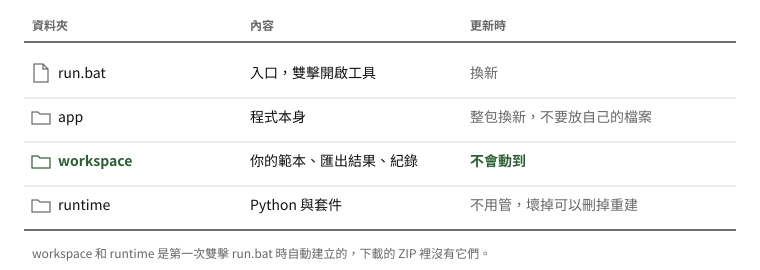

記住一件事就好：**你的範本和匯出結果都在 `workspace`**。`app` 是程式本身，每次更新都會整包換掉，不要在裡面放自己的檔案。

> 全部都在這個資料夾內，電腦上原本的 Python 不受影響，也不會改動系統設定。不想用了，刪掉整個資料夾就好；要保留範本的話，先備份 `workspace\templates`。

### 之後每次使用

雙擊 `run.bat` 就好。那個黑色視窗就是工具本身，**使用時不要關掉**。

用完時，關閉瀏覽器頁面或黑色視窗都可以。關閉頁面約 10 秒後，工具會自動結束，黑色視窗也會跟著關閉。正在解析時關閉頁面，工具會等解析完才結束，但結果來不及匯出就會消失。工具已經開著時再雙擊 `run.bat`，只會開啟原本的工具，不會多開一個。

工具右上角的「使用手冊」連結可以隨時開啟這份手冊，左上角顯示目前的版本號。

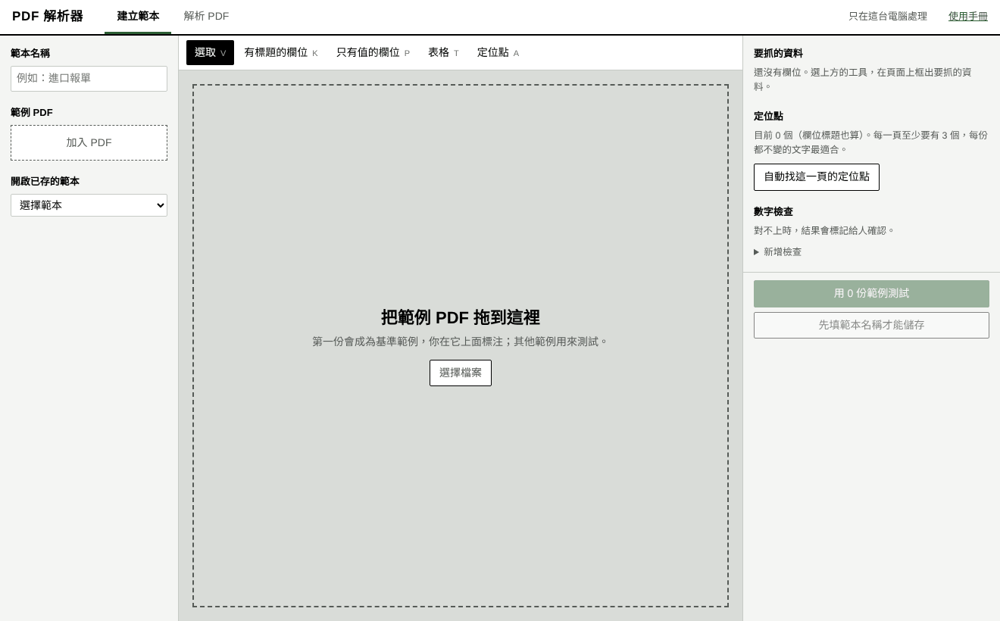

### 更新與退回版本

更新到新版、新版有問題時退回、從 0.1 版升級，都寫在 **[換版說明](換版說明.md)**，有圖解。換版不會動到 `workspace` 裡的範本和匯出結果。

### 公司電腦不能連網，或擋 GitHub

套件已經附在 ZIP 裡，只有第一次的 uv 和 Python 需要從 GitHub 下載。如果公司擋 GitHub：

1. 在一台能連網的 Windows 64 位元電腦上解壓 ZIP，雙擊 `run.bat` 一次，讓它下載完成。
2. 把整個資料夾複製到目標電腦，但不要複製 `runtime\venv`、`runtime\cache` 和 `workspace`。
3. 雙擊 `run.bat`，工具會直接使用複製過來的檔案，全程不連網。

## 3. 先試用：五分鐘看懂流程

工具內附虛構的報單範例和做好的範本，可以先試：

1. 點上方的「解析 PDF」。
2. 「使用範本」勾選 **進口報單（示範）** 和 **商業發票（示範）**。
3. 按「加入 PDF」，選 `app\samples` 資料夾裡全部的 PDF。
4. 按「開始解析」。工具會逐份挑最符合的範本，左邊會顯示每份用了哪個範本。
5. 點左邊的 `sample_5_errors.pdf`。這份故意少一列，稅費合計也是錯的，可以看到工具怎麼標記。

## 4. 建立範本

### 4.1 準備範例

建議準備 3 份以上同種單據，包含明細較多、會跨頁的一份，以及格式略有不同的一份。

1. 點上方的「建立範本」，在左上填範本名稱，例如「進口報單」。
2. 把 PDF 拖進畫面。第一份會自動成為基準範例。**基準範例要選明細有跨到第 2 頁的那份**，才能標注續頁。

要調整範例時：

- **移除一份**：按檔名右邊的「×」。
- **換掉整組**：按清單下方的「全部移除」。範本和已標注的框線都會保留。
- **換基準範例**：按該份下方的「設為基準範例」。

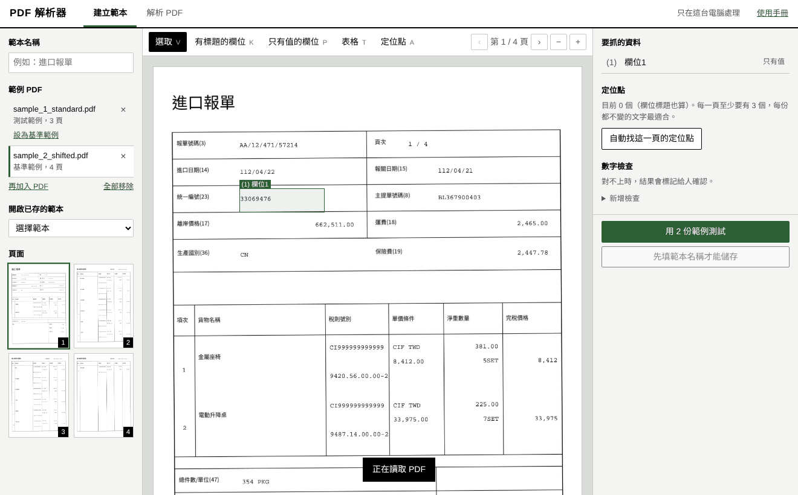

> 更換基準範例時，工具會依定位點自動對位，框線跟著新範例移動，可以按 Ctrl+Z 復原。只找到部分定位點時會先問你要不要移動；完全對不上時（例如不是同一種文件）框線維持原位。新範例頁數比較少時，沒有的那幾頁設定會保留不變，左邊會提示。移除基準範例時，清單中的下一份會自動成為基準範例。

### 4.2 標注有標題的欄位

適用於旁邊有欄位名稱的資料，例如「報單號碼」。

1. 按工具列的「有標題的欄位」。
2. 框住欄位名稱。

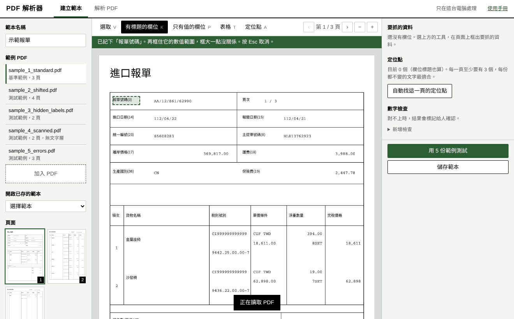

3. 依綠色提示，再框住數值的範圍。框大一點沒關係，但不要碰到隔壁的資料。
4. 右邊會立刻顯示抓到的內容。工具會繼續留在這個模式，可以連續標下一個欄位。

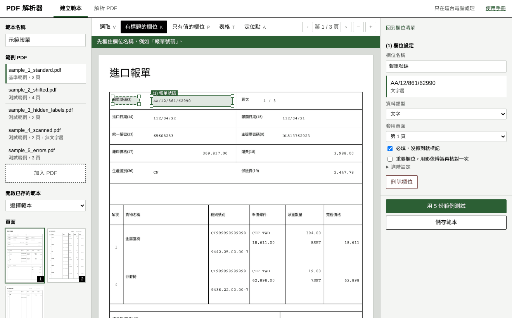

右邊可以改欄位名稱，並選資料類型。選「數字」或「日期」後，格式不對時會被標記。

**內容可能接到下一頁時**：勾選「內容可能接到下一頁」，工具會切到下一頁，再框住內容接續的範圍。那個範圍有內容時會接在後面，並標記給人確認；沒有內容時就不接。這種情況不常見，只有真的會跨頁的欄位才需要勾。

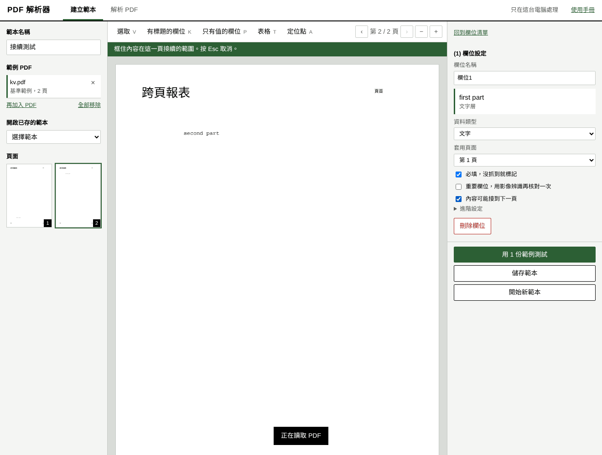

### 4.3 標注只有值的欄位

適用於旁邊沒有欄位名稱，只能靠位置判斷的資料。按「只有值的欄位」，框住數值，再到右邊取名。這類欄位完全靠定位點找位置，請記得加定位點（見 4.5）。

### 4.4 標注表格

**先把表格建起來：**

1. 按工具列的「表格」，框住資料區。**不要包含標題列**，下緣框到明細可能出現的最底部。
2. 在表格內點一下，就會切出一條直欄分隔線。依表格的直欄逐一切好。分隔線可以拖曳移動，雙擊可以刪除。

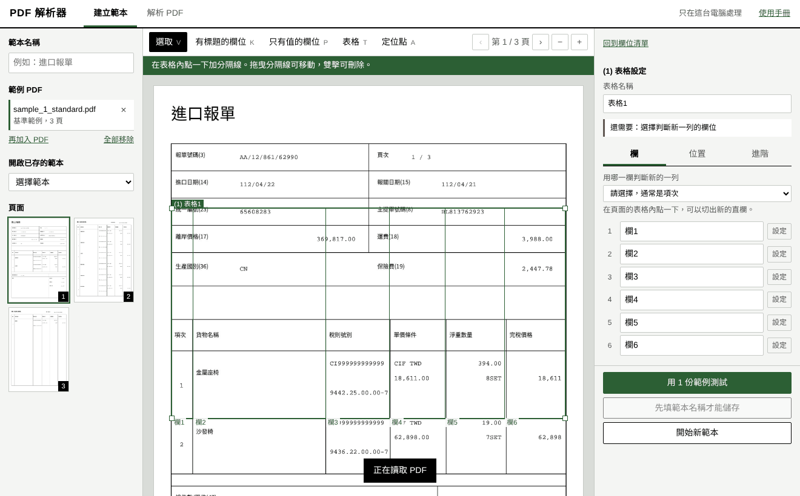

接著看右邊的表格設定。還沒完成的項目會顯示在「還需要」，設定分成三個分頁：

| 分頁 | 內容 |
|---|---|
| **欄** | 欄名、用哪一欄判斷新的一列，以及每一欄的細項 |
| **位置** | 每一頁的範圍、表頭、表格結尾 |
| **進階** | 通常不用動 |

**「欄」分頁：**

1. 替每一欄命名。
2. **在上方選「用哪一欄判斷新的一列」**，通常是項次。這一步很重要，工具靠它判斷明細有幾列。
3. 需要時按該欄的「設定」：
   - **一格有多行時**：選「保留換行」，Excel 會顯示成多行，方便後續拆分。
   - **每一列都一定有這欄**：用來判斷跨頁，說明見下方。
   - **這一欄怎麼取值**：預設是整格內容，什麼都不用設定，內容會完整保留。
   - **同一格拆成多欄**：同一格有多筆資料要分開輸出時才用，每個輸出欄都要選取值方式。

**要拆欄時怎麼選：** 不確定就維持「整格內容」，之後再用第三層處理，這是最安全的做法。

| 取值方式 | 適合情況 | 例子 | 拆不開時 |
|---|---|---|---|
| 第幾行 | 行數固定 | 稅則欄固定上下兩行 | 取不到就是空白 |
| 開頭文字 | 儲存格裡有 key value，只要 value | `ECCN:` | 這格沒有這個開頭就留空 |
| 正規表達式 | 要抓有特定格式的內容 | `ECCN:\s*(\S+)` | 比對不到就留空 |
| 依空格分段 | 每段都不含空格 | `njnnn ji` | 內容放第一段並標記 |
| 依字距分段 | 文字層 PDF，兩筆之間距離明顯比較大 | `two words      ji` | 內容放第一段並標記 |

**用開頭文字抓 key value：** 這是從儲存格裡抽資料的方式，只會取開頭後面的值，開頭之前和這格其他內容都不會帶進來。比對不分大小寫，空白多寡、全形半形、開頭裡的標點有沒有都不影響：設 `ECCN:` 時，`ECCN 5A992`、`ＥＣＣＮ：5A992` 都抓得到；設 `Invoice No` 時，`Invoice No.: 123` 只會取 `123`，開頭後面的冒號、句點、等號不會帶進值裡。「值到哪裡結束」有三種：

| 設定 | 例子：`ECCN: 5A992.c rev 2` 下一行是 `Origin: TW` | 適合 |
|---|---|---|
| 這一行結束（預設） | `5A992.c rev 2` | 每個 key 一行 |
| 第一個空白 | `5A992.c` | 值本身不含空格 |
| 下一個開頭文字 | 接到同一格下一個已設定的開頭為止，折行會接回來 | sub 內容會折行 |

同一行有兩個 key 時，例如 `sub3: njnnn sub4: ji`，把兩個都設成開頭文字就會分開。

> **沒解析成功就留空，不會把整格內容塞進欄位**，原始內容會顯示在確認畫面和 Excel 的「原始內容」，由人判斷。開頭文字和正規表達式是抽取，**沒抽到的內容不會輸出**，某欄整份都沒抓到時會提醒。想保留原文時，按「同一格拆成多欄」，多留一欄用「整格內容」。某欄每列一定要有值時，勾選「每一列都一定有這欄」，沒抓到才會標記。

設定後按「用基準範例試抓這一欄」，可以馬上看到每一列抓到的值，和它的原始內容，不用跑完整測試。

依空格分段時，內容本身有空格就會段數不對或切錯，能用開頭文字時請優先使用。

**「位置」分頁：**

- **明細會跨頁時**：切到第 2 頁，按「在目前這一頁加範圍」，框住該頁的資料區。套用頁面維持「第 2 頁起」。

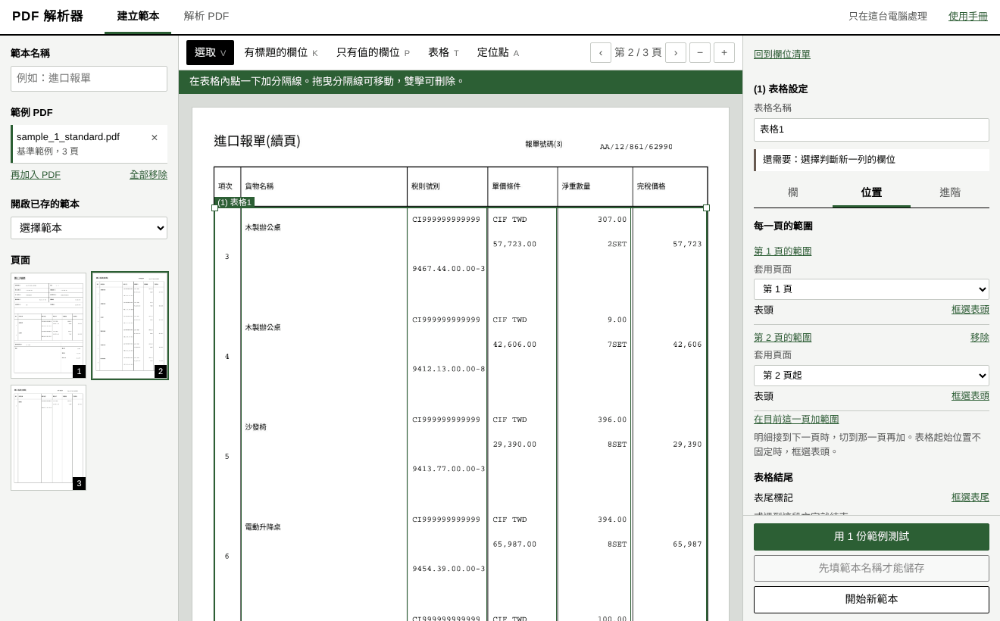

- **表格起始位置不固定時**：按「框選表頭」，框住表頭中每份都一樣的文字，例如第一欄的標題。表格上緣和分隔線都會跟著表頭移動。範圍下緣維持原位，所以請拉到資料可能出現的最底部。
- **表格長度不固定時**：按「框選表尾」，框住表格結束後緊接著出現的文字，例如「合計」。也可以填固定字樣，例如「以下空白」。都不設定時，會抓到範圍底部為止。

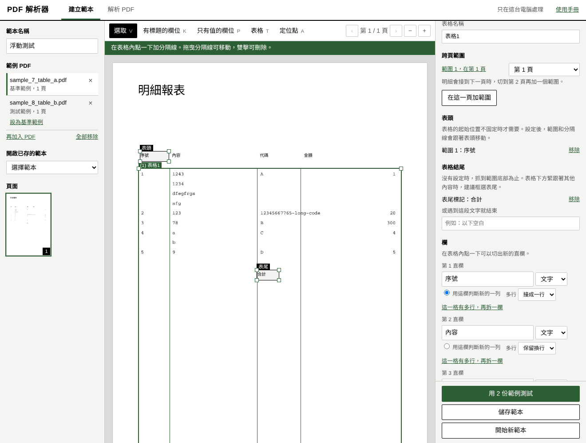

> 找不到表頭或表尾時，工具仍會用範本的固定位置抓取，並標記給你確認。

**內容跨到隔壁欄時**：不用特別設定。工具會以一整段文字為單位分欄，並判斷每一欄靠左或靠右，讓跨欄的內容留在它原本的欄。沒把握時會標記「內容跨到隔壁欄」。同一格拆成多個欄位時（例如用第幾行或開頭文字取值），只有實際用到跨欄那段文字的欄位會被標記。

**同一列跨到下一頁時**：先加好續頁範圍。工具的處理方式取決於項次的位置：

| 項次位置 | 處理方式 |
|---|---|
| 每列第一行 | 下一頁第一個項次之前的內容，自動併回上一列並標記 |
| 列的中間 | 依「每一列都一定有這欄」判斷：上一列缺這欄，就把開頭內容併回上一列並標記；上一列完整，就算作這一頁第一列 |
| 列的中間，但沒有勾選 | 開頭內容比平常高時，留在這一頁第一列，並標記「可能屬於上一列」 |

項次可能在列的中間時，建議把稅則、金額這種每列必有的欄位勾起來。跨頁合併時，換行、只取第幾行和格式檢查都會照該欄的設定處理。

### 4.5 加定位點

**每一頁至少要有 3 個定位點，而且要分散在頁面四周。** 欄位標題會自動算成定位點，但只有第 1 頁有標題時，續頁就要另外加。

1. 切到要加的那一頁。
2. 按右邊的「自動找這一頁的定位點」。
3. 虛線框就是定位點。如果框到會隨單據變動的內容，例如日期或報單號碼，點它再按「刪除定位點」。

也可以按工具列的「定位點」手動框選。

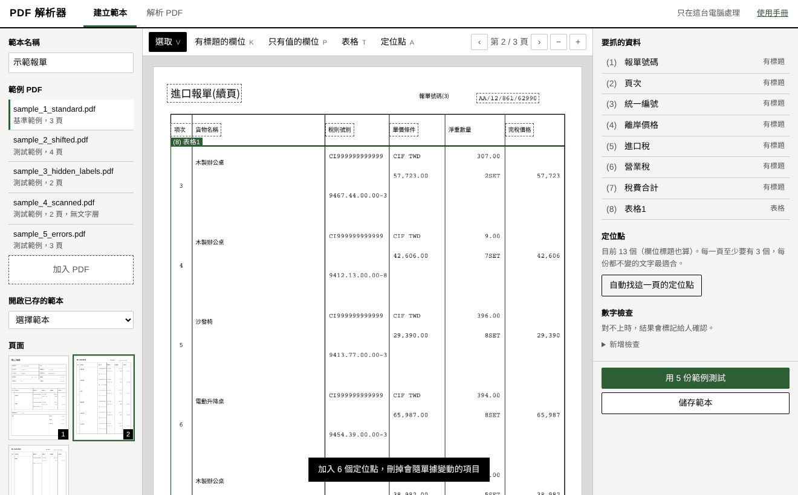

### 4.6 加數字檢查（強烈建議）

這是防止錯誤最有效的方法。金額有加總關係時都建議加上。

1. 右邊「數字檢查」按「新增檢查」。
2. 選檢查方式：幾個欄位相加、表格某欄加總，或比對總頁數。
3. 選好欄位後按「加入檢查」。

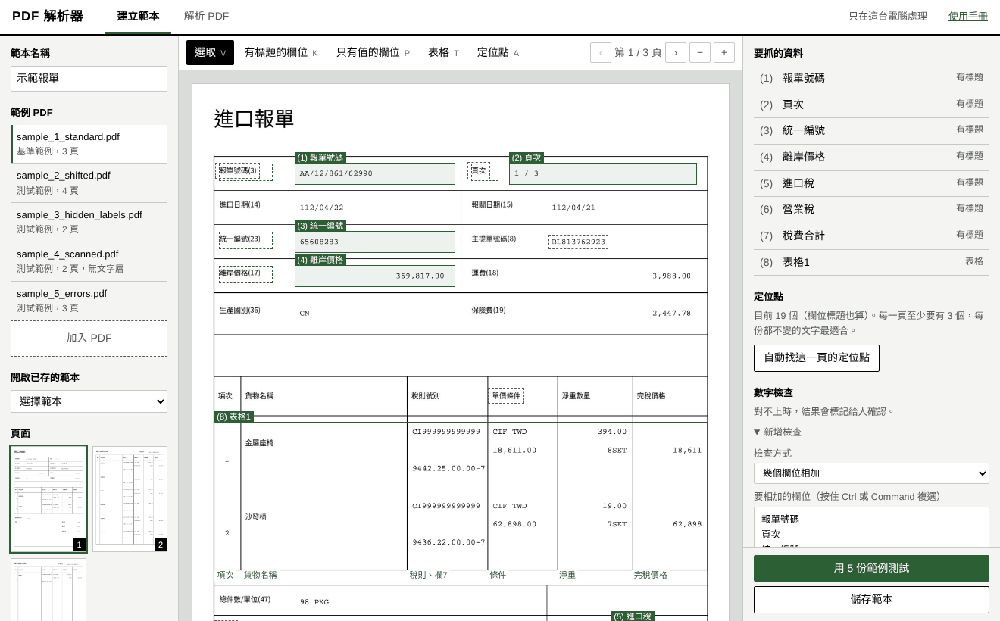

### 4.7 測試

按右下的「用 N 份範例測試」，左邊每份範例都會顯示結果，下方會列出抓到的資料。

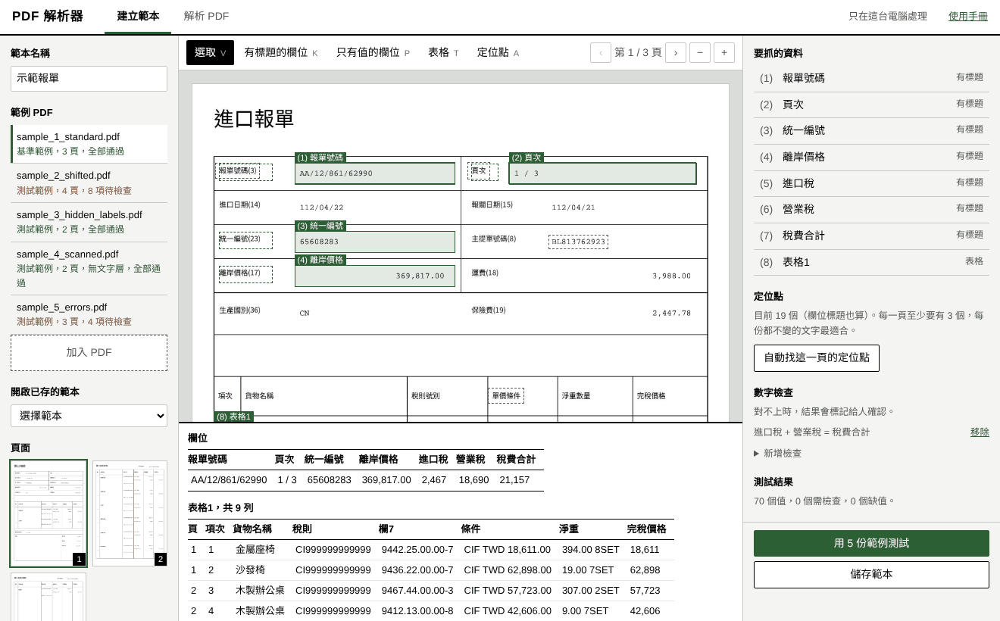

點其他範例逐份檢查。特別留意：

- 列數對不對
- 長品名有沒有被截斷
- 每一欄有沒有對到正確的資料
- 跨頁的地方有沒有漏列

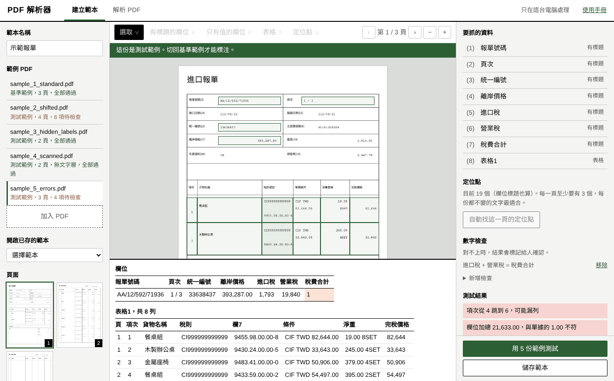

要修改時，先點回左邊第一份基準範例，測試範例上不能標注。

### 4.8 儲存

按「儲存範本」。範本存在 `workspace\templates` 資料夾。測試結果滿意再存；之後修改再存一次就會覆蓋。如果名稱和其他範本相同，工具會先問你要不要覆蓋。

### 4.9 設定輸出欄位（選用）

在右邊欄位清單下方按「設定輸出欄位」，可以勾選要輸出的欄、改輸出欄名，並用箭頭調整順序。這只影響「乾淨資料」，檢查用 Excel 維持完整內容。沒設定時全部輸出，之後新增的欄位也會自動輸出。

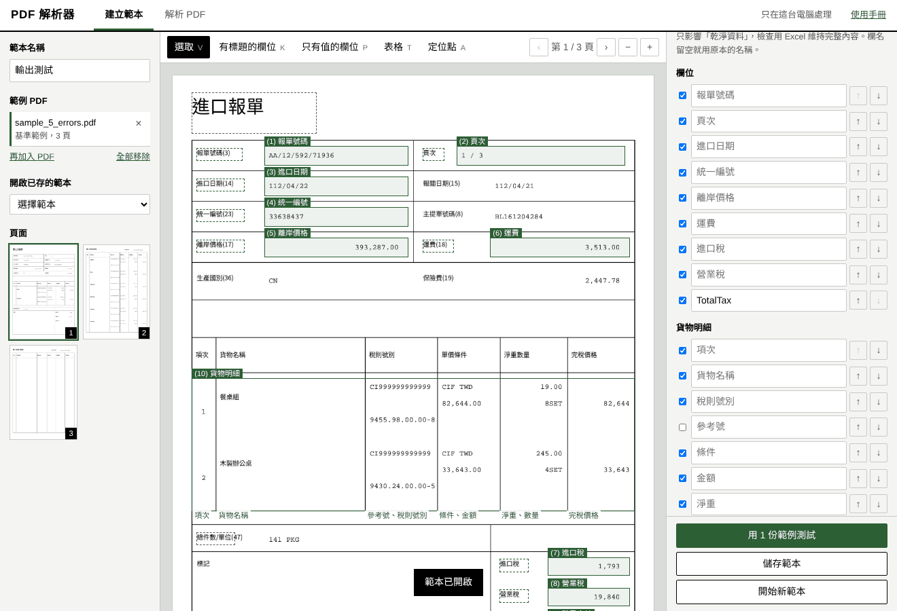

### 4.10 建立下一個範本

存好後按右下的「開始新範本」，畫面會回到空白狀態：範本名稱、框線、定位點、數字檢查、測試結果和範例 PDF 都會清除，已儲存的範本不受影響。如果範本還沒儲存，工具會先提醒。

## 5. 解析 PDF

1. 點上方的「解析 PDF」。
2. 勾選範本。可以複選，不確定是哪一種單據時，就把可能的範本都勾起來。
3. 拖入 PDF，可以一次放多份。加錯時按檔名右邊的「×」，或按「全部移除」換一組。
4. 按「開始解析」。一般 PDF 通常每頁約 1 秒內，掃描檔每頁約數秒，視電腦而定。
5. 逐份檢查右邊的「待檢查」項目：
   - 點項目，頁面會跳到該位置並框起來。
   - 值是對的：直接按「確認」，內容和換行都會保留。
   - 值是錯的：改成正確的值，再按「確認」（Enter 也可以，Shift+Enter 換行）。
   - 處理過的項目會移到下方的「處理紀錄」，標成藍色，寫著原本為什麼要檢查、確認了什麼或改成什麼。按「還原」可以放回待檢查。
   - **沒有被標記的值也能改**：在下方的結果表格按兩下那一格就能直接修改（Enter 儲存、Shift+Enter 換行、Esc 取消）；或點一下那一格，在右邊「選取」修改。改過的會保留原值，也列在處理紀錄。
6. 依用途匯出，檔案會下載，同時保留一份在 `output` 資料夾：
   - **匯出檢查用 Excel**：有顏色、待檢查清單和原圖截圖，給人核對。
   - **匯出乾淨資料**：純表格，給 Power Query 或 Python 接後續處理。勾「乾淨資料只輸出已確認」可以排除還沒處理的資料。

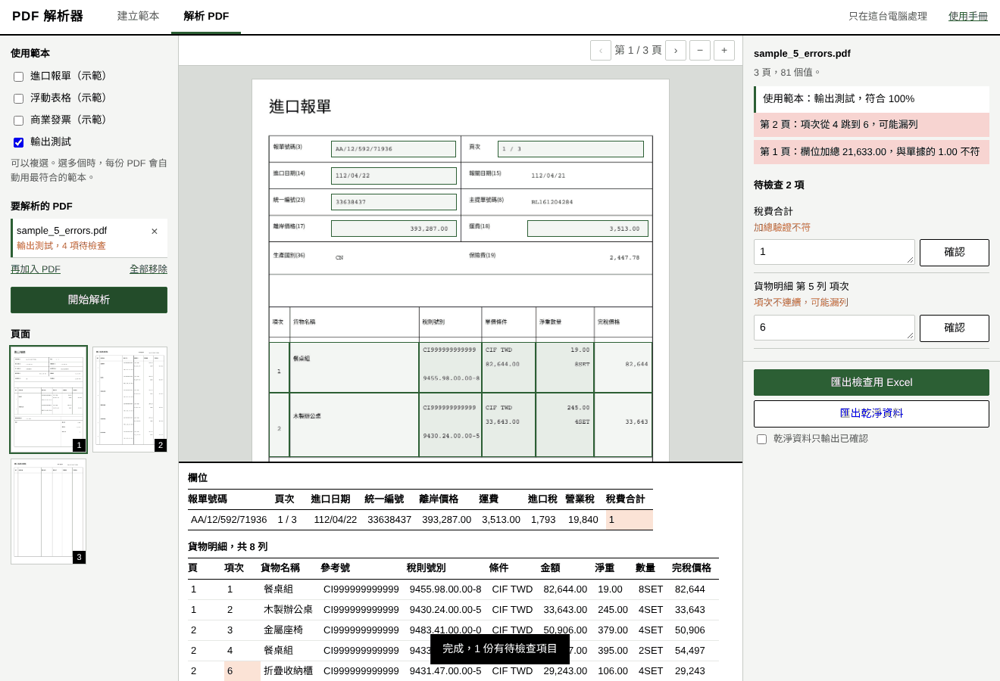

### 用兩個視窗核對

PDF 和結果表格都可以移到另一個視窗，例如一個螢幕看 PDF、另一個螢幕看表格：

- PDF 上方的「在新視窗開啟」：PDF 移到新視窗，主視窗的表格會變大。
- 結果表格上方的「在新視窗開啟」：表格移到新視窗，主視窗的 PDF 會變大。

兩邊會同步：在表格點一格，另一個視窗的 PDF 會翻到那一頁並框起來；在任何一個視窗修改，待檢查和處理紀錄都會跟著更新。要收回時，按新視窗的「收回到主視窗」或主視窗的「收回」。主視窗關閉或重新整理時，新視窗會一起關掉。

> 瀏覽器擋住新視窗時，請在網址列右邊允許這個網站開啟彈出式視窗。

### 選多個範本時

工具會先比對每個範本的定位點，再實際解析分數接近的範本，挑問題最少的那個。左邊清單會顯示每份用了哪個範本，右上方會列出各範本的符合度。

- 兩個範本分數接近時，會標記「分數接近，請確認用對範本」。
- 所有範本都找不到定位點時，會標記「可能沒有適用的範本」，這份的資料不要直接採用。

符合度看的是定位點，所以範本的定位點要選該單據獨有的文字。如果每個範本的定位點都是相似的內容，就比較難分辨。

> 重新按「開始解析」會產生全新結果，之前的人工修正不會保留。關閉頁面或工具後，尚未匯出的結果也會消失，瀏覽器會先提醒。請確認完再匯出。

## 6. 看懂 Excel

| 工作表 | 內容 |
|---|---|
| **待檢查** | 所有需要人看的項目，附原因和原圖截圖；已處理的也會列出，「處理」欄寫著確認或改成什麼 |
| **檔案總覽** | 每份 PDF 用了哪個範本、符合度、挑選方式和檢查結果 |
| **欄位資料** | 每份 PDF 一列，並標示使用的範本 |
| **表格名稱** | 例如「貨物明細」，每個品項一列，並標示來自哪個檔案和哪一頁 |

一批 PDF 用到多個範本時，每個範本的資料會分開成各自的工作表，例如「欄位_進口報單」和「欄位_商業發票」，不同範本的欄位不會混在一起。

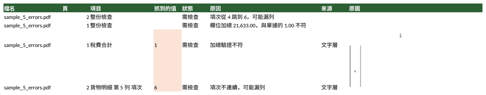

| 顏色 | 意思 |
|---|---|
| 橘色 | 需檢查，滑鼠移到儲存格可看原因 |
| 紅色 | 必填但沒抓到 |
| 藍色 | 已人工確認或修改，註解有原始值和原本的原因 |

所有值都以文字原樣保存，例如 `1,234.50` 不會被改動。需要計算時，請在 Excel 轉成數字，或交由第三層客製化處理。

### 乾淨資料

沒有顏色和說明，第一列就是欄名。每種範本的欄位和表格各一張工作表，每列都會附上：

| 欄 | 內容 |
|---|---|
| 來源檔名、範本 | 資料來自哪份 PDF、用哪個範本 |
| 頁碼、列號 | 表格資料才有，方便回頭查 |
| 檢查狀態 | 正常、已確認、已修正、需檢查或缺值 |
| 檢查原因、整份檢查 | 這一列的疑點，以及這份 PDF 的整體問題 |

預設會輸出全部資料，請用「檢查狀態」決定後續要不要濾掉。直接排除未確認資料時，那些列不會出現，後續彙總可能少算，請特別留意。

## 7. 標記的意思與處理方式

| 標記 | 原因 | 怎麼處理 |
|---|---|---|
| 影像辨識信心偏低 | 字跡不清或解析度低 | 對照原圖修正 |
| 文字層與影像辨識結果不同 | 兩種方式讀出來不一樣 | 對照原圖修正 |
| 文字層是亂碼，已改用影像辨識 | PDF 內的文字無法解碼 | 核對這個值 |
| 文字層沒有內容，且影像辨識無法使用 | 影像辨識沒有成功載入 | 執行 `.\run.bat doctor` 檢查 |
| 內容壓到框線 | 框太小，可能少抓字 | 回到範本把框放大 |
| 內容跨到隔壁欄 | 分隔線不準，或文字本來就壓線 | 調整分隔線，或核對值 |
| 這一頁對位不穩 | 定位點太少或太集中 | 多加分散的定位點 |
| 這一頁找不到定位點 | 定位點都找不到 | 確認範本適用，或補定位點 |
| 欄位標題位置與其他欄位偏移不一致 | 這份版面可能不同 | 核對值，必要時另建範本 |
| 格式與設定不符 | 例如數字欄讀到文字 | 核對值或調整欄位類型 |
| 必填欄位沒有抓到值 | 該位置沒有內容 | 核對原檔或調整框 |
| 加總驗證不符 | 數字對不上 | 分別核對加總項目與合計 |
| 項次不連續（提示） | 大多數項次連號，但有幾處跳號，可能漏列 | 查看跳號的地方；項次本來就不連號可忽略。這是提示，不算進待檢查，項次本來就不連號時也不會出現 |
| 這一列可能跨頁，已合併 | 這個欄位的值用到兩頁的內容，或是推測併到上一列的；同一格拆成多欄時，只標值真的跨頁的欄位 | 確認合併結果，點項目可看兩頁的位置 |
| 這頁開頭的內容可能屬於上一列 | 項次在列的中間，無法判斷；只標在第一個項次上方有內容的格子 | 核對這一列和上一列；勾選「每一列都一定有這欄」可減少這類標記 |
| 段數和設定不符，已留空 | 依空格或字距分段時，實際段數不同 | 看原始內容後手動填入；這類資料可改用開頭文字 |
| 擷取規則比對不到，已留空 | 欄位的格式擷取沒有比對到 | 看原始內容後手動填入，或調整規則 |
| 整份都沒有抓到值 | 開頭文字或公式可能不對 | 回範本用「用基準範例試抓這一欄」檢查 |
| 這一列缺必要欄位 | 勾選為每列必有的欄位沒抓到 | 查看是否跨頁或切錯列 |
| 內容接到下一頁，已合併 | 欄位設定了接續範圍 | 確認接起來的內容 |
| 同一行有兩段內容搶同一欄 | 這欄平常一行只有一段，這一行卻在分隔線旁多出一段，可能是隔壁欄的內容 | 調整分隔線，或核對值。格子裡本來就有大空白（例如單位和數字）或用字距分段的欄位不會標記 |
| 找不到表頭 | 這份沒有表頭，或表頭長得不同 | 確認表格位置；續頁沒有表頭時，移除該範圍的表頭 |
| 找不到表尾標記 | 這份沒有表尾文字 | 檢查最後幾列有沒有多抓內容 |
| 可能不適用此範本 | 定位點找到不到一半 | 換範本，或為新版面建範本 |
| 兩個範本分數接近 | 自動選擇時難以分辨 | 確認用對範本，或替範本加上獨有的定位點 |
| 可能沒有適用的範本 | 選取的範本都找不到定位點 | 這份資料不要採用，為它建立範本 |

> **沒被標記不等於百分之百正確。** 尤其是掃描檔，影像辨識可能以高信心讀錯字。金額等關鍵資料請設定數字檢查，或在欄位勾選「重要欄位，用影像辨識再核對一次」。新範本上線初期也建議抽查。

## 8. 進階設定

欄位和表格的「進階設定」平常不用動。以下是常見用法：

| 需求 | 設定 |
|---|---|
| 從「第1頁/共11頁」取出 11 | 從內容擷取：`共\s*(\d+)\s*頁` |
| 統一編號必須是 8 碼數字 | 格式檢查：`^\d{8}$` |
| 稅則格式檢查 | 格式檢查：`^\d{4}\.\d{2}\.\d{2}\.\d{2}-\d$` |
| 只取框內第二行 | 取第幾行：`2` |
| 項次格式不是純數字，例如 A01 | 新一列的格式：`^[A-Z]\d+$` |
| 表格遇到「以下空白」就結束 | 遇到這段文字就結束表格：`以下空白` |
| 項次固定在每列最上方 | 列判斷欄的位置：在列的最上方。這樣跨頁的半列會併回上一列 |

## 9. 管理範本

- **備份與分享**：範本就是 `workspace\templates` 裡的一個 JSON 檔。複製給同事，放進他的 `workspace\templates` 資料夾就能用。
- **修改**：在「建立範本」加入 PDF，再從「開啟已存的範本」選擇。不一定要用當初那份基準範例，同一種文件的其他 PDF 也可以，框線會依定位點自動對位。對位後請用「測試」確認一次。
- **單據改版**：新版面請另存一份範本，例如「進口報單 2027 版」，舊版繼續用來處理舊單據。
- **更新工具**：範本不受影響，步驟見[換版說明](換版說明.md)。

## 10. 檔案與資料安全

| 資料夾 | 內容 |
|---|---|
| `workspace/templates` | 範本，請備份 |
| `workspace/output` | 匯出的 Excel |
| `workspace/custom` | 第三層客製化腳本 |
| `workspace/uploads` | 上傳到工具的 PDF 暫存複本 |
| `workspace/logs` | 操作與錯誤紀錄，只記檔案代號，不記檔名和抓到的值 |

工具結束時會清除 `workspace/uploads` 裡的 PDF 暫存；如果是直接關閉黑色視窗或電腦當機，下次啟動時會清除。處理機密文件後若不打算再開工具，請手動刪除 `workspace/uploads`。`workspace/output` 的 Excel 含截圖與資料，不會自動清除，請依公司規定保管。

工具只接受本機（127.0.0.1）的連線，其他網站無法透過瀏覽器讀取或操作工具裡的資料。遇到錯誤時，畫面只顯示一般訊息，詳細原因寫在 `workspace/logs/pdfmapper.log`，回報問題時附上這個檔案即可。紀錄檔超過 1 MB 會換新檔，最多保留 5 份，超過 30 天的會刪除。

不要把真實單據放進版控。專案已設定忽略 `workspace` 和 `app/samples` 以外的 PDF。

## 11. 批次自動化（選用）

熟悉指令的人可以不開網頁，在工具資料夾開啟命令視窗執行。指令列模式不會檢查更新，也不會停下來等你按鍵，可以放進排程：

```powershell
# 解析整個資料夾
.\run.bat run -t workspace\templates\進口報單.json -i D:\報單 -o workspace\output\結果.xlsx

# 多種範本時，每份自動挑最符合的
.\run.bat run -t workspace\templates -i D:\報單

# 同時輸出乾淨資料，並排除未確認的資料
.\run.bat run -t workspace\templates\進口報單.json -i D:\報單 --clean workspace\output\乾淨資料.xlsx --only-confirmed

# 匯出前套用第三層客製化
.\run.bat run -t workspace\templates\進口報單.json -i D:\報單 --post workspace\custom\我的處理.py

# 檢查環境
.\run.bat doctor
```

第三層客製化的寫法請參考 `app\examples\custom\example_transform.py`，複製到 `workspace\custom` 再修改，更新工具時才不會被蓋掉。

## 12. 常見問題

**顯示「無法下載 uv」或「環境建立失敗」**
通常是公司網路阻擋 GitHub 或 PyPI，請改用第 2 節的離線安裝。

**安裝到一半中斷**
重新執行 `run.bat` 會接續完成。還是失敗時，刪除 `runtime` 資料夾再試一次。

**瀏覽器沒有自動開啟**
看黑色視窗裡顯示的網址，例如 `http://127.0.0.1:8765`，貼到瀏覽器。

**畫面顯示「影像辨識無法使用」**
文字層仍可讀取，但掃描內容讀不到。刪除 `runtime` 資料夾後重新啟動，讓工具重新安裝。

**整欄資料都偏了一格**
檢查分隔線位置，以及每個輸出欄對應的直欄。

**表格列數不對**
確認有選「用這欄判斷新的一列」，以及表格範圍有包含所有列。續頁要另外加範圍。舊範本的「列判斷欄的位置」不會自動改變，如果列切錯了，可以在「進階」分頁改成「自動判斷」。

**最後一列多抓到下面的內容**
設定表尾標記，或把範圍下緣往上拉。

**表格位置常常對不上**
設定表頭。如果連每一欄的寬度都不同，表示版面已經不一樣，請另建一份範本。

**後面幾頁都抓不到**
通常是續頁沒有定位點，或表格沒有加第 2 頁起的範圍。

**畫面顯示「工具已經關閉」**
黑色視窗被關掉了。重新執行 `run.bat`，再重新整理頁面。上傳的 PDF 需要重新加入，未儲存的範本會在左上方詢問要不要接著做，已儲存的範本請從「開啟已存的範本」開啟。

**更新後有問題**
執行 `run.bat rollback` 退回上一版，並把 `workspace/logs/pdfmapper.log` 和版本號回報給負責人。詳細步驟見[換版說明](換版說明.md)。

**一份 PDF 顯示解析失敗**
可能有密碼保護或檔案損毀，請先解除密碼或重新下載。其他檔案不受影響。

**自動選錯範本**
通常是定位點不夠有區別。替範本加上該單據獨有的文字當定位點，或解析時只勾選正確的範本。

**測試很準，實際跑卻常被標記**
範例不夠有代表性。把被標記的檔案加入範例，調整框線和定位點後重新儲存。

## 13. 快捷鍵

| 按鍵 | 功能 |
|---|---|
| V | 選取 |
| K | 有標題的欄位 |
| P | 只有值的欄位 |
| T | 表格 |
| A | 定位點 |
| Esc | 取消目前動作 |
| Delete | 刪除選取項目 |
| Ctrl + Z 或 Cmd + Z | 復原 |
| Page Up / Page Down | 換頁 |
