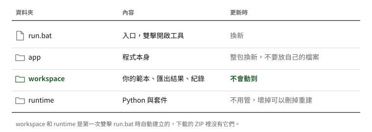
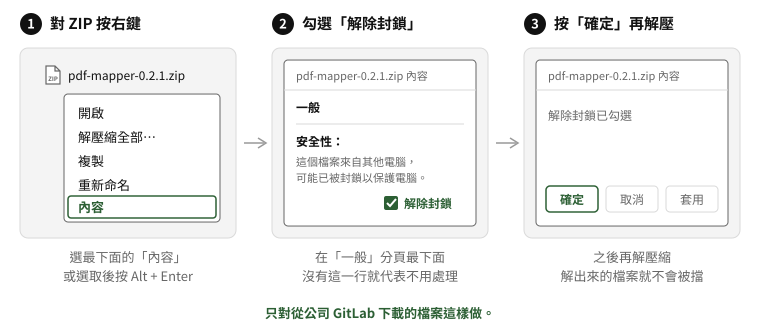
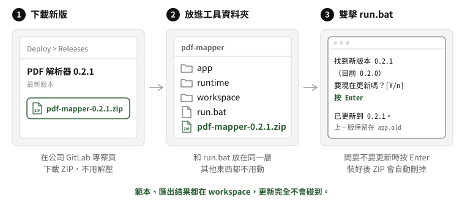
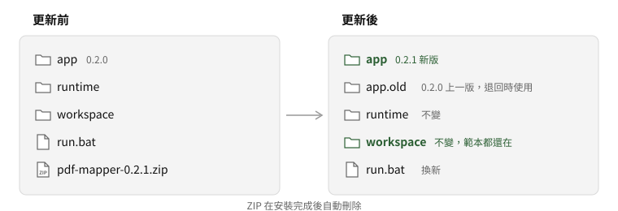
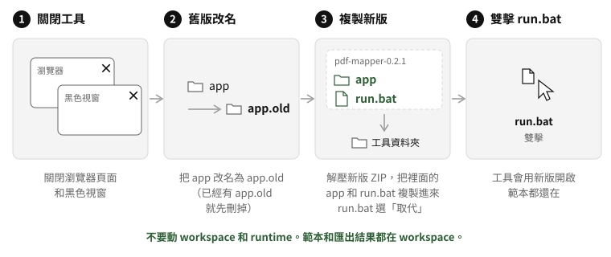

# PDF 解析器換版說明

這份說明怎麼更新到新版、新版有問題時怎麼退回。換版不會動到你的範本和匯出結果。

## 1. 先認識工具資料夾

記住一件事就好：**你的範本和匯出結果都在 `workspace`**。`app` 是程式本身，每次換版都會整包換掉，不要在裡面放自己的檔案。

## 2. 解除封鎖（從瀏覽器下載的 ZIP 要先做）

從瀏覽器下載的檔案，Windows 會標記成「來自網路」。直接解壓的話，雙擊 `run.bat` 可能跳出安全性警告或沒有反應。

**什麼時候要做**：第一次安裝，以及第 5 節的手動更新，這兩種情況要自己解壓 ZIP，解壓前先做這一步。第 3 節的一般更新不用解壓，所以不需要。

1. 對下載的 `pdf-mapper-版本.zip` 按右鍵，選 **內容**。
2. 在「一般」分頁最下面，勾選 **解除封鎖**。沒有這一行，代表檔案沒有被封鎖，不用處理。
3. 按 **確定**，再對 ZIP 按右鍵 > **解壓縮全部**。

只對從公司 GitLab 下載的檔案這樣做。公司不允許解除封鎖的話，請找負責人。

## 3. 更新到新版

負責人發布新版時會通知大家。更新只要三步：

1. 到公司 GitLab 專案的 **Deploy > Releases**，下載新版的 `pdf-mapper-版本.zip` 和 `SHA256SUMS.txt` 兩個檔案。**不用解壓。**
2. 把兩個檔案都放進工具資料夾，和 `run.bat` 同一層。
3. 雙擊 `run.bat`。工具會先核對 ZIP 和 `SHA256SUMS.txt`，相符才會問「要現在更新嗎？」，按 Enter，接著工具會用新版開啟。

核對是為了確認 ZIP 下載完整，而且是負責人正式發布的那一份。對不上的時候工具不會安裝，會繼續用目前的版本開啟。

更新只換掉 `app` 和 `run.bat`，舊版會改名為 `app.old` 留著，`workspace` 完全不動：

想確認目前版本，看工具畫面左上角，或在命令視窗執行 `run.bat version`。

## 4. 新版有問題：退回上一版

1. 關閉工具。
2. 在工具資料夾的網址列輸入 `cmd`，按 Enter，會開啟一個命令視窗。
3. 輸入 `run.bat rollback`，按 Enter。

工具會換回 `app.old` 裡的上一版。之後想回到新版，再執行一次 `run.bat rollback` 就好。請把版本號和 `workspace\logs\pdfmapper.log` 回報給負責人。

指令沒有反應時，也可以手動換：關閉工具，把 `app` 改名為 `app.new`，再把 `app.old` 改名為 `app`。

## 5. 自動更新失敗時：手動更新

黑色視窗顯示「更新失敗」時，工具會繼續用舊版開啟，資料不受影響。這時可以手動更新：

1. 關閉工具：關閉瀏覽器頁面和黑色視窗。
2. 把工具資料夾裡的 `app` 改名為 `app.old`。如果已經有 `app.old`，先把舊的刪掉。
3. 對新版 ZIP 先做第 2 節的解除封鎖，再按右鍵 > **解壓縮全部**。打開解壓出來的資料夾，把裡面的 `app` 資料夾和 `run.bat` 複製到工具資料夾。問要不要取代 `run.bat` 時，選「取代」。
4. 雙擊 `run.bat`，工具會用新版開啟。

**不要動 `workspace` 和 `runtime`**，也不要把整個新資料夾覆蓋到舊資料夾上，以免舊版的檔案殘留。

## 6. 從 0.1 版升級

0.1 版的資料夾裡有 `start.bat` 和 `templates`，沒有 `run.bat`，所以要手動升級一次：

1. 關閉工具，對新版 ZIP 做第 2 節的解除封鎖，再解壓縮。
2. 把解壓出來的 `app` 和 `run.bat` 複製到舊的工具資料夾。
3. 改用 `run.bat` 啟動。工具會自動把 `templates`、`custom` 複製到 `workspace`，`output` 搬到 `workspace\output`，已下載的 uv 和 Python 也會沿用。
4. 確認範本都在之後，可以刪除舊的 `start.bat`、`start.ps1`、`start.sh`、`pdfmapper`、`templates`、`custom`、`samples`、`.tools`、`.venv`。

之後的版本就照第 3 節更新。

## 7. 常見問題

**黑色視窗顯示「找不到核對資料」或「對不上」**
少了 `SHA256SUMS.txt`，或 ZIP 沒下載完整。回到同一個 Release 頁，重新下載兩個檔案再試一次。瀏覽器把核對檔存成 `SHA256SUMS (1).txt` 也沒關係，不用改名。還是對不上的話，不要手動安裝，請找負責人確認。

**放了 ZIP，雙擊 `run.bat` 卻沒有問要不要更新**
檔名要是 `pdf-mapper-版本.zip`，例如 `pdf-mapper-0.2.1.zip`。瀏覽器重複下載時會變成 `pdf-mapper-0.2.1 (1).zip`，改回原本的檔名即可。比目前版本舊或相同的 ZIP 會被略過，黑色視窗會提示可以刪掉。

**更新後範本不見了**
確認是從同一個工具資料夾開啟。範本在 `workspace\templates`，換版不會動到它。

**`app.old` 可以刪嗎**
可以。刪掉後就不能用 `run.bat rollback` 退回，下次更新時會再產生一份。
